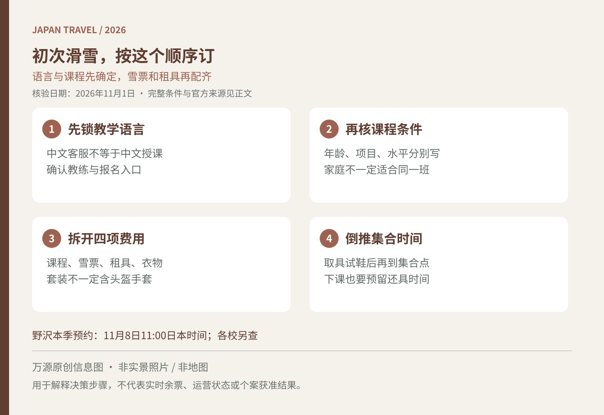

第一次去日本滑雪，容易先买便宜雪票，再发现当天没有能听懂的课程，或者租具店与集合点在雪场两端。准备11月至12月的预订时，建议按“课程、票券、租具、到场动线”排序；雪场公布开季计划，也不代表初学课程和练习区会在同一天全部开放。

<figure>
  
  <figcaption>万源原创出行信息图，非实景照片或地图；适用范围与细节见正文。</figcaption>
</figure>

## 先确定能听懂的课程，再选双板或单板

报名时写明从未滑过、参加过几次课，或能否自主停下和转弯，不只勾选含糊的“初级”。双板与单板是不同课程，同一家庭也未必能同组。想选私人课时，确认人数上限以及不同水平能否合班；平摊费用便宜，不代表每位成员都能获得适合自己的课程。带孩子先核对年龄、独立参加要求、午餐与接送安排；成人会一点，不等于能在儿童班旁边一起学习。

语言不能靠网页翻译解决。JNTO建议旺季需要英语教练的游客提前预约，因为相应教练数量有限。会中文的客服，也不等于授课教练使用中文。付款前取得教学语言的明确确认，涉及儿童时尤其不要让孩子临场靠猜。[JNTO滑雪课程准备](https://faq.japan-travel.jnto.go.jp/en/guide/skiing/)

若需要外语教学，可从雪场公布的认可学校名单继续核对，不凭社交平台上一句“当地教练”判断其获准在该雪场授课。野沢温泉另列有公认外语学校说明。[官方外语学校说明](https://nozawaski.com/report/cat-school/22202/)

## 11月预约，先看本季开放日而非旧价格截图

野沢温泉已公布，2026–27季双板与单板相关课程于**11月8日11:00（日本时间）**开始预约，原则上线上提前预约、提前付款，预约日前不受理。这是该雪校的时间，不是日本所有雪场统一开售日；其他学校应查各自日历。[2026–27季预约公告](https://nozawaski.com/school/25524/)

尚未开放时，可先列两个可行日期、教学语言和人数，不必反复试付款。课程开售后，再检查当天实际可订产品与取消条款。若想12月初学习，直接问“初学区未开放时课程如何处理”，不要只问山顶有没有雪。雪季初期的交通与开季差异，可结合[二世古12月初准备](/blog/d-20261021-090004)理解，但不能把那里的计划套到本州雪场。

## 总预算分四栏，避免买了两次雪票

把预算分成课程费、雪票、器材租赁、衣物与小件四栏。询问课程是否含缆车票、含哪一区域、从几点开始有效；若学校要求另买，按其建议选择，不因“全山票看起来划算”就提前购买。

器材套餐名称也要逐项读。例如GALA汤泽把双板三件套列为雪板、雪鞋和雪杖，单板两件套列为雪板和雪鞋；雪服、头盔与雪镜另列，手套属于销售商品。不能把“租一套”理解为从内衣到手套全包，更不能把一个雪场的项目推广到全日本。[GALA官方租赁项目](https://gala.co.jp/winter/rental/)

GALA同页还明确，2026年12月12日至18日为观光营业阶段，不能进行双板或单板滑雪；冬季时段从12月19日起列示。计划12月初学习的人，不应因为页面已有租赁信息就认定当日可滑。

租赁前准备身高、鞋码等商家要求的信息，确认儿童与特殊尺码是否可提供。现场试穿后如有明显不合适，应请工作人员调整；不要为了赶上开课而带着不合适的装备离店。租具预约是否可改日期、提前取件是否加费，也应写入订单核对表。

## 把到场时间倒推到“穿好装备”，不是下车时刻

同一雪场可能有不同入口和租赁区域。野沢温泉官方租具目录就区分日影、长坂及村内商店；选店前先在地图上标出课程集合点。[官方租具位置目录](https://nozawaski.com/winter/facilities/)

倒推顺序是：课程集合、走到集合点、试鞋取具、换衣寄物、交通抵达。具体提前量以学校要求为准，不给所有雪场套一个固定分钟数。下课后还要留还装备、换衣和乘车时间，末班接驳不能当作还具截止。

若只计划体验半天，可先确认课程与往返交通能否衔接，再决定住一晚还是当天返回。与朋友分开上课时约好课后集合地点，别依赖在雪道上随时接电话。出发前按[日本旅行行李清单](/blog/b-20261009-063200)检查随身物品，并将防寒衣物与租赁清单逐项对照。

资料核验于2026年11月1日（日本时间）。本文未查询实时课程名额，教学、租赁与雪道开放以所选学校及雪场当日公告为准。
