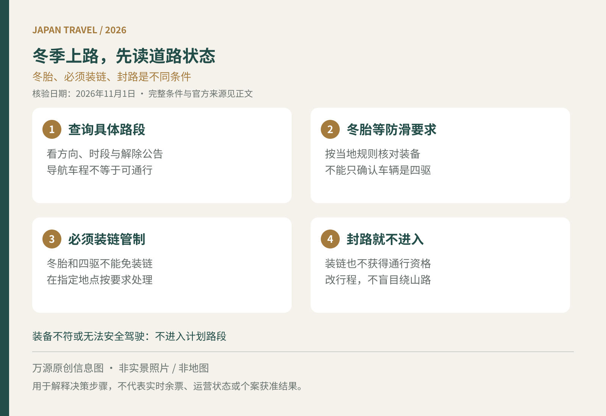

11月至12月去北海道、长野或富士山周边自驾，即使出发城市没有下雪，山路、清晨与傍晚仍可能是另一种路况。订车时只选“四驱”，或者看到导航仍显示路线，都不足以决定能否出发。真正要核对的是具体道路公告、车辆装备，以及驾驶者是否具备应对条件。

<figure>
  
  <figcaption>万源原创出行信息图，非实景照片或地图；适用范围与细节见正文。</figcaption>
</figure>

## 先分清三种状态，不把“链条”两个字看成同一规则

第一类是积雪、结冰道路的防滑要求。关东地方整备局提醒，在可能因积雪或结冰打滑的道路行驶，应按法规使用冬季轮胎或防滑链等措施。各地具体规则与现场管制应另行确认，不能理解为全国在某个固定日期一律换胎。[关东官方雪道提示](https://www.ktr.mlit.go.jp/road/bousai/road_bousai00000010.html)

第二类是国土交通省所说明的大雪时“防滑链未安装车辆禁止通行”管制。该制度针对指定路段与实施时段；即使已经装冬胎，或车辆是四驱，**没有按要求装链仍不能通过**。这与一般冬胎限制有区别，也不是冬天经过名单中的道路就全天候必须装链。[国土交通省防滑链管制问答](https://www.mlit.go.jp/road/bosai/fuyumichi/tirechains.html)

第三类是道路封闭，包括预防性封路、冬季长期封路等。此时装链也不意味着获得通行资格。不要把“我的装备更好”作为驶入封闭区的理由；雪道安全准备与道路是否开放是两件事。

## 取车前用书面清单确认，不只看车型照片

将实际旅行日期、经过的山口或高速区间发给租车公司，确认交付车辆是否配备适合路线的冬胎、防滑链是否可提供、型号是否匹配，以及使用限制与费用。若只得到“可以去滑雪场”的笼统答复，应继续问清装备，不自行推断已经包含。

拿到车辆后，请工作人员说明链条装在哪些轮位、如何安装和收纳，按照车辆与产品说明操作。国土交通省问答指出，链条以装在驱动轮为基本原则，并说明喷涂药剂式产品不能用于满足该项必须装链管制。四驱车辆的具体装配位置不要靠猜。[装链位置与产品说明](https://www.mlit.go.jp/road/bosai/fuyumichi/tirechains.html)

如果没有雪地驾驶经验、无法可靠完成安装，或租车公司不能提供所需装备，最可执行的选择是改用运行中的公共交通、调整目的地或取消山路段。先确认合法驾驶证件，再讨论雪地装备，证件要求可参阅[日本租车取车检查](/blog/b-20261015-090000)。

## 查预报之外，还要查道路是否准备关闭

天气预报告诉你可能发生什么，道路管理公告告诉你哪些路能走。国土交通省道路防灾页提供通行管制、预防性封路与道路信息入口；遇大雪可能将并行高速和国道同时封闭，因此“高速封了就走国道”并非可靠备用。[官方道路防灾与管制入口](https://www.mlit.go.jp/road/bosai/bosai.html)

订行程时先保存道路运营方页面，出发前一天与当天再次核对。注意公告中的方向、起终点、预计实施时间与解除状态；名单上有路段，并不等于此刻正在管制。地图软件显示预计车程，也不能替代道路管理者的通行公告。

把旅程最后一晚安排得更有余量，避免从山间住宿出发后马上衔接国际航班。若预报明显恶化，及早询问住宿和租车的改退条件，不等到路障前才逐个打电话。

## 真正的备用方案，应包含“不走这段”

出发前约定触发条件：道路已封、公告建议避免出行、装备不符合要求，或驾驶者判断无法安全驾驶，就不进入计划路段。不要为酒店不可退款或已经买了雪票而继续冒险。

需要装链时遵从道路管理方指定地点与现场人员指引，不在行车道上临时停车练习。冬胎、四驱与防滑链都不能保证零风险；缓慢行驶、留足距离并不能使封路自动失效。若临时改坐铁路或巴士，继续确认其运行状态，参考[日本电车停运时的路线调整](/blog/b-20261013-090001)。

资料核验于2026年11月1日（日本时间）。本文解释一般旅行决策，不代表当前路况或具体路线通行许可；请以相关道路管理者、警方及租车公司的最新指引为准。
