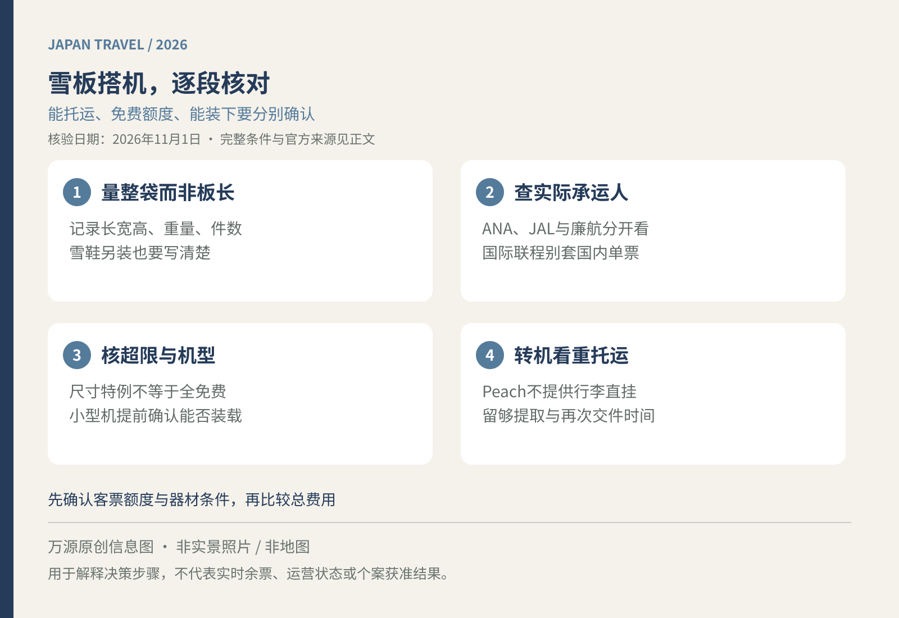

带自己的雪板去北海道，国内段机票便宜，不代表加上器材运输后仍最合适。雪板长、雪鞋重，还可能涉及小型机和再次托运。订2026冬季行程时，先做一张行李表，再比较航班，不要到柜台才问“运动器材是不是都免费”。

<figure>
  
  <figcaption>万源原创出行信息图，非实景照片或地图；适用范围与细节见正文。</figcaption>
</figure>

## 先量整只袋子，再问航空公司

记录装好后的长、宽、高、重量与件数，尺寸应包含外露把手、轮子和鼓起部分；同时写明双板或单板、雪鞋是否另装，以及另外还有几个旅行箱。板长只是其中一个数字，不等于航空公司需要的包装后尺寸。

例如装好后的袋子为170×30×20厘米，三边合计是220厘米，不是按170厘米去比较三边总和标准。这只是计算示例，不代表该袋一定获准托运；真正询问时，把三边和最长边都报给航空公司，避免客服和旅客各说不同的“尺寸”。

将航班日期、便名及实际承运人放在同一张表上。代码共享航班、国内接国际联程和另买的国内机票，不能只凭票面上熟悉的品牌判断。往返若不同航空公司，应分别核对，不能用去程柜台的放行当作回程承诺。

## ANA：运动器材尺寸有特例，但仍需看票价与机型

ANA当前国内线运动器材页把滑雪板、单板列入可受托运用品，免费额度随票价种类不同。其尺寸特例显示，三边合计超过158厘米、至292厘米以内不收尺寸超限费，但仍受机型和航线限制；超过203厘米的行李，应提前提供尺寸及重量联系航空公司。[ANA国内线运动器材](https://www.ana.co.jp/ja/jp/guide/boarding-procedures/baggage/domestic/bicycle/)

这不能简化成“292厘米内全部免费”：重量、件数和可装载长度仍是不同限制。雪板、雪杖、雪鞋分开包装时，也要分别核算可能的超额费用。先看电子客票上的额度，再向承运人确认，别沿用多年以前的统一公斤数。[ANA免费托运额度](https://www.ana.co.jp/ja/jp/guide/boarding-procedures/baggage/domestic/free/)

## JAL：免费重量与能否装进货舱分开判断

JAL国内线页面列示每人20公斤内免费、头等舱45公斤内免费，件数不限；超出普通尺寸的运动器材，则以货舱能够装载为前提。页面按机型列有长度参考值，并提醒即使在参考值内，也可能因装载和天气等因素无法接受。[JAL国内线托运行李](https://www.jal.co.jp/jp/ja/dom/baggage/checked/)

因此，一袋雪板只有十几公斤，也不能跳过长度检查。搭乘地方机场间的小型机尤其应提前询问。JAL同时说明，使用国际线机票搭乘国内段时按国际线行李处理；这不等于另外购买的一张国内票自动享有国际额度。

## Peach：查尺寸超限选项，不再照旧买“运动器材”

Peach已于2024年12月2日结束旧“运动器材”项目销售，冬季新预订应按现行托运行李与超限选项核算。别被旧攻略里的滑雪器材固定收费表误导。[Peach运动器材规则变更说明](https://cs.flypeach.com/hc/ja/articles/4659119875230-%E3%82%B9%E3%83%9D%E3%83%BC%E3%83%84%E7%94%A8%E5%93%81%E3%81%AF%E9%A0%90%E3%81%91%E3%82%89%E3%82%8C%E3%81%BE%E3%81%99%E3%81%8B)

现行页面列出普通托运行李三边合计203厘米以内；204厘米以上需要尺寸超限选项，且各边仍不得超过80、80、230厘米的上限。单件超过20公斤至32公斤另需重量超限选项。费用还随票价、路线与办理渠道变化，付款前应同时看到托运基础费用和所需超限费用。[Peach现行托运规则](https://www.flypeach.com/lm/ai/airports/baggage/checked_in_bag)

Peach也明确不提供行李直挂服务，多段乘机须逐段领取与重办托运。预留时间应包括大件提取、重新排队与安检，不能只计算两架飞机之间的时差。[Peach多航段衔接说明](https://www.flypeach.com/lm/fares/multi/multiple_seg_conditions)

## 打包后拍照，行程也留一条备选

用自己的器材袋或充分包装保护装备，确认标签牢固，保留打包照片与托运凭条。充电宝不要塞进雪鞋袋一并托运，随身电池规则可看[日本航班充电宝规定](/blog/b-20261023-090002)。装备以外的登机流程，参阅[日本国内航班出发检查](/blog/b-20261014-090008)。

若装载条件难确认，可比较目的地租具或配送方案，但配送也需另查尺寸、时效和收件安排。联系过航空公司并不等于所有现场条件下保证装载；尤其首日已订早课时，不宜把器材抵达与上课时间压得过紧。领取后发现损坏，应尽快向承运人报告并保存记录。

资料核验于2026年11月1日（日本时间）。本文未替具体客票计算费用，购买与出发前请按实际承运人、票价和机型复核。
