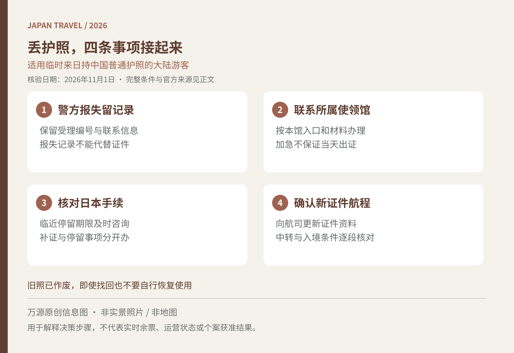

在日本发现护照不见，最重要的是尽快把“寻找原件”与“恢复可用旅行证件”分开处理。本文面向临时来日、持中国普通护照的中国大陆游客；长期在日居民、其他国籍或港澳台旅行证件持有人，应查对应程序，不能照搬同一材料清单。

<figure>
  
  <figcaption>万源原创出行信息图，非实景照片或地图；适用范围与细节见正文。</figcaption>
</figure>

## 先留下报失记录，同时联系所属使领馆

向最近的警署或交番说明遗失或被盗情况，保存受理编号、地点和联系信息，并询问可以取得何种书面记录。报失材料有助于后续办理与保险沟通，但不能代替护照或旅行证登机。JNTO建议遗失旅行证件后联系签发机关，办理补证时准备警方记录。[JNTO旅行证件遗失提示](https://www.japan.travel/en/plan/emergencies/)

酒店、铁路或商店的失物查询可以继续进行，具体找物路径见[日本旅行遗失物品处理](/blog/b-20261011-090000)。不过，距离返程很近时，不要只等失物中心回电。用官方网页核对自己所在地对应的中国使领馆及证件业务联系方式，说明当前城市、遗失经过、拟回国日期和可提供的身份材料。

## 旅行证适用，但办理入口并非全国一套

驻札幌总领馆的专门说明适用于临时来日后护照遗失、被盗或损毁、急于回国的中国公民，并要求申请人按窗口办公时间直接到馆，不能邮寄或委托代办。驻名古屋总领馆的绿色通道也提示，此类临时来日人员直接到馆办理。[札幌旅行证申请说明](https://sapporo.china-consulate.gov.cn/lsfw/lszj2025/hzlxz/202502/t20250228_11566247.htm)｜[名古屋绿色通道](https://nagoya.china-consulate.gov.cn/lsfw/a5/202406/t20240605_11377204.htm)

这些是具体馆的安排，不应改写成“全日本必须先在APP排队”，也不能推断所有领馆都无需预约。先看本馆最新通知、办公日和受理地点，再决定是否出发前往；使馆总馆地址、领事证件窗口与签证中心也可能不是同一地点。

## 材料先按身份、遗失经过与照片整理

先准备原护照资料页照片或复印件、身份证或户口簿等可提供的身份资料，以及清楚的遗失时间地点记录。驻日本使馆材料指南列有原护照信息页、适用时的身份材料与遗失损毁说明；未满16周岁申请人还涉及监护关系凭证、监护人证件及声明。[驻日本使馆材料指南](https://jp.china-embassy.gov.cn/lsfw_0/zjfw_138408/zhjfw1/202407/t20240722_11457562.htm)

照片规格、张数、表格和是否需打印，应按受理馆要求准备。没有护照照片也不必自行放弃，向馆方说明可用材料并询问替代方式。不要把护照号码、身份证和孩子出生证明发进公开求助群；只通过核实过的官方渠道提交。

建议建立一个离线文件夹，分别保存身份材料、警方记录、机票酒店与受理沟通。记录案件或申请编号，后续询问时沿用，避免同行人各自重复提交造成信息不一致。

## 出证、停留手续和登机，是三条需要衔接的线

札幌说明指出，身份核查需要联系原发照机关，办理时间不能确定。即使可以申请加急，也不等于保证当天取得证件。先向航空公司询问改签选择，不要在获知可取证时间前反复购买不可退的新票。

如果日本获准停留期限已临近，立即向日本出入国在留管理机关咨询所需手续，不把领事补证进度当作停留期限处理结果。日本入管问答说明，遗失护照后取得新护照，如希望转记有效的上陆许可等记录，可向管辖机关申请，并携带已有的遗失证明；使用旅行证的具体情形，请直接说明并确认。[日本入管手续问答](https://www.moj.go.jp/isa/immigration/faq/kanri_qa.html)

拿到新证件后，核对姓名与出生日期，并向航空公司更新证件信息；涉及第三国转机或返回其他常居国，应逐段确认所持旅行证件与签证条件，不能因为能够回中国，就推断其他航程同样适用。

## 找回原护照，也不要自行恢复使用

补证申请受理、原证件作废与找回后的处理，应听从使领馆指引。札幌说明明确，申请后又找到原护照也不可撤回申请，应尽快交馆注销；已宣布作废的护照不能因为物理上找到了就重新使用。

额外住宿、改签与补证费用是否获赔，须查看自己的保单，可参考[旅行保险出险留证清单](/blog/b-20261031-120007)。资料核验于2026年11月1日（日本时间），本文为一般准备指南，个案材料、停留及登机资格以有关机关和承运人确认为准。
