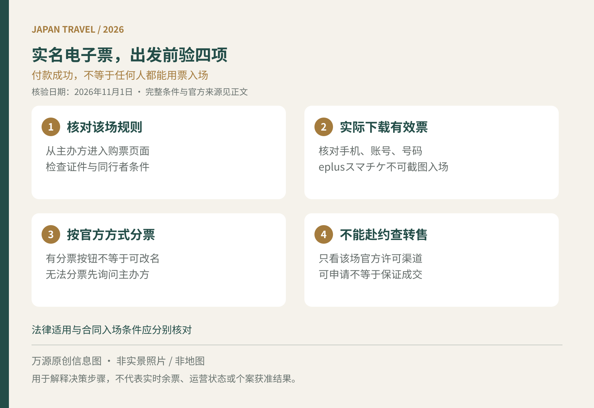

为了年底的一场演唱会飞去日本，最需要提前确认的往往不是座位朝向，而是票是否能由你本人使用。付款记录、卖家截图和“保证带入场”都不能替代主办方的入场条件。本文聚焦实名电子票与转售，不把所有日本演出、所有票务平台写成同一种规则。

<figure>
  
  <figcaption>万源原创出行信息图，非实景照片或地图；适用范围与细节见正文。</figcaption>
</figure>

## 先从主办方确认入口，查清谁必须到场

从艺人、场馆或主办方官网进入票务页面，记录演出日期、场次、购票人和同行者要求。重点寻找“本人確認”“同行者登録”“譲渡禁止”“公式リセール”等栏目。是否核验每位观众、可用哪些证件、名字如何填写，均应以该场公告为准。

持外国护照购票时，先问是否接受护照原件，以及票面姓名需要何种写法；不要自行判断中文名、拼音或账号昵称必然可以互相替代。需要同行者预登记的票，也别等朋友行程未定时随手填一个人名。遇到不清楚的条件，向官方客服说明“海外旅客”再付款。

把身份材料交给陌生卖家，不会使不符合条件的票变得可用。要求借用他人证件、代刷脸或隐瞒真实使用人的交易，应停止推进。票是真是假、合同是否允许转让、入场者能否通过核验，是不同问题。

## 手机能上网，不等于能显示有效票

以eplus的“スマチケ”为例，官方要求通过对应应用下载，下载开放时间随公演不同；截图或录屏不能用于入场。下载后删除应用或更换手机，也可能导致票券消失，因此出发前不要随意重装。[eplusスマチケ使用指南](https://eplus.jp/sf/guide/spticket)

涉及电话号码认证时，申购登记号码与使用号码要一致；eplus提示，申购后变更号码可能无法下载。海外手机也需核对兼容性，不应因为收到邮件就认为准备完成。先确认应用能安装、账号能登录，再在开放下载后实际检查票是否出现。

旅行上网方案与票务电话验证应分开看。只提供数据流量的产品，不能凭“能收邮件”推断满足特定平台的电话认证。准备前可读[日本旅行上网选择](/blog/b-20261010-090004)，但最终仍须符合票务方要求。

## 同行分票不等于随意改名或转售

eplus虽提供LINE或邮件分票，但明确部分公演不可分配，应下载到演出当天可用的手机。Ticket PIA的“Myチケット”也区分发券、分配与转售，接收分票者需要完成相应会员与电话号码认证。[PIA分票与发券说明](https://t.pia.jp/guide/myticketservice.jsp)

两个人同行，最好在出发前确认各自持票方式，以及是否必须一同入场。孩子没有手机、同行者临时更换、购票人不能到场，都应向主办方询问，不能把应用出现“分配”按钮当作可绕过实名限制的许可。普通景点票的二维码准备，可另看[日本景点电子门票检查](/blog/b-20261013-090003)。

## 法律禁止范围与主办方禁转让规则，分别判断

文化厅说明，日本禁止的是符合条件的“特定兴行入场券”的不正当转售。其消费者问答将核心条件解释为：未经主办方同意、超过原售价、具有反复持续转售意图的经营性转售；即使仅发生一次，也可能根据意图认定。不能简单说所有转让都触犯同一法律。[文化厅消费者问答](https://www.bunka.go.jp/seisaku/bunka_gyosei/ticket_resale_ban/pdf/ticket-resale-qa-customer.pdf)

反过来，也不能说“原价买来就一定能进”。主办方合同、实名和入场限制仍可能适用。是否属于该法律的特定票券、无法赴约可以如何转让，文化厅建议向相应主办方确认。[文化厅官方说明](https://www.bunka.go.jp/seisaku/bunka_gyosei/ticket_resale_ban/)

## 不能赴约，先查官方转售，不把它当免费取消

PIA官方转售并非覆盖所有公演；是否可申请还与取票方式、是否已发券等状态有关，申请后未成交不会退款。海外旅客还应提前确认收款账户条件、费用与期限，不把“支持转售”理解为一定能拿回全部支出。[PIA转售申请规则](https://t.pia.jp/guide/resale-entry.jsp)

付款前保存该场规则和订单，出发前确认有效票、证件与手机，入场当天留足客服核验时间。资料核验于2026年11月1日（日本时间）；本文不提供实时余票，也不替具体交易判断法律责任，以该场主办方及官方票务平台最新条件为准。
