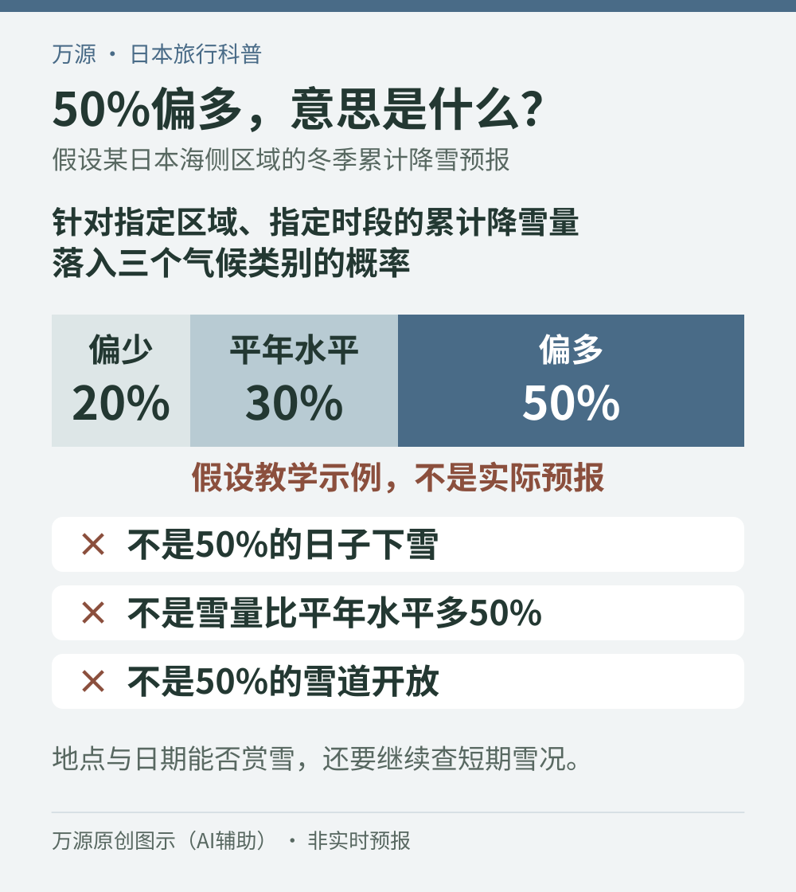
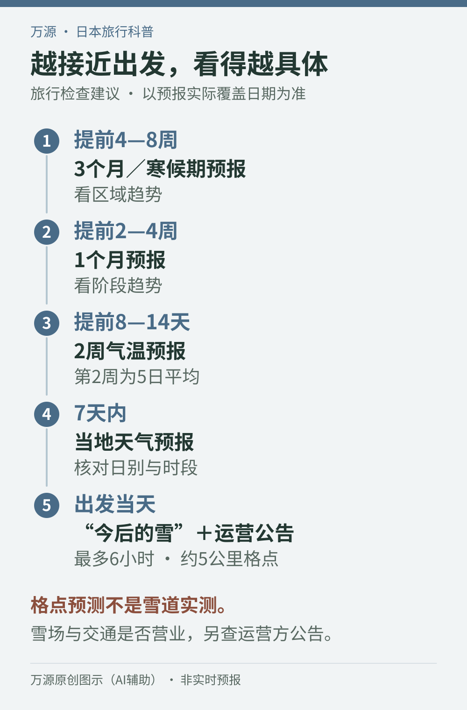

11月开始订12月或元旦的日本旅行，很多人最想问的是：“那几天会有雪吗？”气象资料能帮助缩小不确定性，却不能提前两个月给某个雪场、某个周末开出保证书。真正有用的做法，是把问题拆成三层：**这个季节的区域趋势、临近出发的降雪与积雪、目的地当天实际提供的活动。**

这三层信息对应不同的决定。早期决定目的地和能承受的退改成本；临行决定衣物、出行节奏和备用方案；当天决定是否按原计划前往。本文核验于**2026年11月4日（日本时间）**，解释官方产品与读法，不发布任何地区当前雪量、今冬必然冷暖或雪场实时开放结论。

## 先把“有雪”问具体：飘雪、雪景和能滑雪，需要不同证据

想看雪花落下，应关注到访时段是否有降雪；想拍地面雪景，要看目的地当时的积雪；想滑雪，则还要确认对应雪道、缆车和课程是否开放。同样一句“下雪了”，对这三种愿望的意义并不相同。

日本气象资料中的“降雪量／降雪の深さ”，描述一定时段内的降雪深度，通常以厘米表示，必须连同时段阅读。“積雪の深さ”描述地面已经堆积的雪有多深，重点是地点与时刻。“截至早上9点的24小时降雪量”和“早上9点的积雪深”不能互换。[气象厅：降水与雪的用语](https://www.jma.go.jp/jma/kishou/know/yougo_hp/kousui.html)

雪层会随时间沉降，也会融化，所以过去几天的降雪量相加，不会自动等于今天的积雪深。一个地方今天没下新雪，仍可能保留此前的积雪；刚开始飘雪，也不代表地面已经形成你期待的厚雪景。札幌管区气象台也明确解释，累计降雪量与积雪深会因沉降、融化出现差别。[札幌管区气象台：雪量与积雪深](https://www.jma-net.go.jp/sapporo/tenki/kansoku/snow/yuki_kaisetu.html)

因此，询问酒店或景区时，可以直接说：“我们想在开放区域看自然积雪，不滑雪”“孩子需要正在开放的玩雪区”，而不只问“最近有没有下雪”。需求说清楚，得到的答复才更接近这趟旅行真正需要的条件。

## 季节预报的50%，到底在说什么

季节预报常把气温分为“偏低、平年水平、偏高”，把降水或降雪量分为“偏少、平年水平、偏多”，分别给出概率。它描述的是**指定区域、指定时段的统计量落在哪个类别**，并非每天的天气日历。

截至本次核验，气象厅用于划分这三类的基准为1991至2020年。将对应区域和时段的30年数值排序，中间10年的范围为“平年水平”，低于或高于这个范围分别落入另两类。各地、各时段的门槛不同，所以“偏少”也不能跨地区直接比较成“哪里一定更少雪”。[气象厅：三个类别的定义](https://www.jma.go.jp/jma/kishou/know/kisetsu_riyou/class/index.html)

假设某个日本海侧区域的冬季累计降雪预报给出：偏少20%、平年水平30%、偏多50%。这是本文自设的教学数字，不是2026年实际预报。它表示“偏多”这个类别的可能性最高，但另两类相加仍有50%的可能性。不能把它读成“半个冬天都下雪”“雪量比往年增加50%”，更不能读成“有一半雪道会开放”。[气象厅：概率表达的读法](https://www.jma.go.jp/jma/kishou/know/kisetsu_riyou/explain/index.html)

<figure>
  
  <figcaption>万源原创图示（AI辅助）。20%、30%、50%均为假设示例，非实际预报；依据日本气象厅说明整理。</figcaption>
</figure>

“暖冬”也要按这个思路读。气象厅所说的暖冬，与12月至2月的平均气温类别有关，不能推出每天都暖、每座山都无雪。旅行时应该问“我需要的日期和活动，在偏暖情形下是否仍值得去”，而不是仅凭一个全季标签立刻取消或锁死行程。[气象厅：暖冬与季节预报常见问题](https://www.jma.go.jp/jma/kishou/know/kisetsu_riyou/faq/index.html)

## 为什么能谈冬季趋势，却不能提前两个月挑出“下雪那天”

预报时间越远，初始观测中的微小误差越可能放大。季节预报会计算多种可能的演变，再用集合预报方法处理不确定性；同时考虑变化较慢的海洋与大气相互作用，寻找一段时间的整体倾向。[气象厅：预测方法与误差](https://www.jma.go.jp/jma/kishou/know/kisetsu_riyou/method/index.html)

这解释了一个看似矛盾的情况：一个月平均偏冷可以有参考价值，但其中某个星期六几点下雪仍无法可靠确定。平均值保留了较慢的趋势，也抹去了每天的波动。对游客而言，季节预报适合支持“提前准备什么、哪些订单留弹性”，不适合支持“已经选中一个月后最好的雪景日”。

这里还有一个11月初很容易误读的细节：**页面暂时没有降雪概率栏，不等于预报无雪。**气象厅的一月预报只在指定季节发布日本海侧降雪量，北日本与东日本对应11月15日至3月1日期间发布的预报，西日本对应12月1日至2月14日期间发布的预报。三个月预报也有地区和发布月份限制。查看时先确认产品本来是否提供这一项，不能把缺项补成零。[气象厅：季节预报的内容与适用季节](https://www.jma.go.jp/jma/kishou/know/kisetsu_riyou/content/index.html)

## 从出发前两个月到当天，逐步换用更合适的信息

以下是旅行检查节奏，不是气象厅规定的订票时限。每次都应先读**发布时间、实际覆盖日期、地区与指标**；“三个月预报”不意味着从你打开页面那天开始重新计算三个月。

<figure>
  
  <figcaption>万源原创图示（AI辅助），非实际预报；依据日本气象厅说明整理。各阶段是旅行检查建议，覆盖日期以实际预报为准，第2周气温为5日平均。</figcaption>
</figure>

### 提前4至8周：决定目的地与订单弹性

查看[气象厅季节预报](https://www.jma.go.jp/bosai/season/)中的三个月预报，安排12月至2月旅行时也可参考寒候期预报。先看区域气温和相应降雪趋势，再判断旅行目标是否过度依赖自然雪。

此时更有价值的操作，是核对住宿、课程和交通的取消截止与费用，并把这些日期写在同一张表里。若唯一目标是初学滑雪，先问初学区未开放时学校怎样处理；若本来就想住温泉、吃饭和散步，少雪时仍可能保留大部分体验。可变更订单的价值来自保留选择，不代表之后一定能无损取消所有项目。

### 提前2至4周：更新趋势，不把每一周排成晴雪日历

一月预报可用于观察阶段性的冷暖变化。它提供一月整体趋势，并有第1周、第2周、第3至4周的平均气温信息；这些仍不是逐日下雪表。[气象厅：一月预报的范围](https://www.jma.go.jp/jma/kishou/know/kisetsu_riyou/content/index.html)

这时复查一次订单退改节点，并准备真正不依赖降雪的替代活动。室内展馆或市区用餐可以作为候选；另一处同样依赖积雪的雪地活动，不能自动算作少雪时的备用。替代项目也要核对营业日期、预约与来回交通。

### 提前8至14天：看气温变化，认清第2周的“5日平均”

气象厅两周气温预报的第2周使用5日平均值。图上某个中心日期对应它前后各两天，而不是那一天单独的最高或最低气温。第一周的逐日值与第二周的平均值，也不能当成同一种数据直接连接解读。[气象厅：两周气温预报说明](https://www.jma.go.jp/jma/kishou/know/kurashi/twoweek.html)

例如中心日期标为12月10日，应理解为相应的12月8日至12日平均，而非已经预报12月10日下午的体感。用它检查防寒准备、提醒同行者可能有冷暖变化，随后等更近的逐日信息补充细节。

### 7天内：切换到实际目的地的逐日天气

用[当地天气与一周预报](https://www.jma.go.jp/bosai/forecast/)检查到访日、往返日的天气、温度与风，并读文字说明中的山地、平地或区域差别。只看酒店所在地的一个图标，会漏掉上山后的条件。

同为长野县，北部与中南部平地的冬季气候就存在明显差异，高海拔地区又有山地气候特点。“长野晴天”不足以代表全县山区。对山脚与山顶安排，分别确认对应地点，不用城市温度减去一个固定数值来替代实际山地信息。[长野地方气象台：地形与气候差异](https://www.data.jma.go.jp/nagano/shosai/kikou/kikou.html)

### 出发当天：看短时雪况，再查运营方

打开[气象厅“今后的雪”](https://www.jma.go.jp/bosai/snow/)，确认图层是积雪深还是某段时间的降雪量，并检查时间轴。这个产品把分析与预测放在一起，未来部分最多到6小时后，约5公里网格、每小时更新。网格表示区域平均状况，不是某条雪道、停车场或人行道的实测值。[气象厅：短时间降雪预报的用途与限制](https://www.jma.go.jp/jma/kishou/know/kurashi/snow.html)

因此，地图上一块颜色适合帮助理解附近的雪量分布，却不能证明景区入口已经清理完成。随后还要看景区、雪场与交通运营方的当日公告，核对更新时间；若只找到前一天公告，就把当天状态视为尚待确认。

## 两个容易造成错误决定的“跨一步推理”

### 从降水概率直接跳到“会积雪”

降水概率回答的是指定时段内达到一定降水量门槛的可能性，不直接回答降多少厘米雪、能积多厚。原有的[日本天气预报与降水概率读法](/blog/b-20261014-090004)解释了这个指标；赏雪旅行还必须继续看雨雪类型和积雪情况。

尤其接近雨雪转换条件时，简单用“零度以上就是雨”判断并不可靠。气象厅特别提醒，地面气温约1至3℃、强风或高空有暖空气等情形，都可能降低雪量分析与预测精度。遇到这些情况，更应保留调整余地，而不是把手机上一个精确数字当成现场保证。[气象厅：雪量产品的精度限制](https://www.jma.go.jp/jma/kishou/know/kurashi/snow.html)

### 从积雪深直接跳到“可以完成我的活动”

积雪数字必须有地点。山顶报告不自动代表山脚初学区，观测站也不自动代表酒店门口。即使同一雪场公布了积雪，还应继续看你要用的缆车、雪道、玩雪区和课程各自状态。

以二世古官方页面的结构为例，天气与缆车状态另设查询入口，游客需要核对具体运营信息，不能只停留在雪票或雪季介绍页。这里引用的是信息入口，不代表已确认2026年11月4日开放滑雪。[Niseko United：天气与缆车状态](https://www.niseko.ne.jp/en/niseko-lift-status/)

不确定是否开课时，问学校“我订的日期和级别是否能正常进行，何时确认，取消或改期按哪项条款处理”。课程、雪票与租具的组合，可继续参考[第一次滑雪预约顺序](/blog/b-20261101-090005)。这比只问一句“雪够不够”更能减少付款后的误会。

## 把预报变成决定：出发前写下这五项

1. **旅行目标**：想看飘雪、看地面积雪，还是需要某类开放雪道？只写最重要的一项。
2. **目标地点**：具体景区、山脚或山顶、课程集合处，不只写县名或城市名。
3. **订单节点**：酒店、课程、租具和交通分别何时进入下一档取消费用。
4. **复查依据**：远期看季节趋势，近期看当地天气，当天查雪况与运营状态，保存各自官方入口。
5. **调整办法**：少雪时做什么、天气恶劣或停运时如何留在安全地点，不为追雪临时深入未确认开放的区域。

看雪旅行最实用的准备，不是寻找一个永远不变的预报，而是让每个决定都用上当时已经能知道的信息。提前两个月留选择，临行一周补细节，当天以现场与运营公告落实行程，才不容易把“冬季趋势不错”误当成“我那一天的体验已经确定”。

*资料核验：2026年11月4日（日本时间）。文中概率图为假设教学示例，流程图为旅行检查建议；没有采用实时雪况或具体日期的预测值作出出行保证。遇恶劣天气，应优先查看[气象厅大雪与暴风雪信息入口](https://www.jma.go.jp/jma/bosaiinfo/snow_portal.html)、当地指示与运营方最新公告。*
