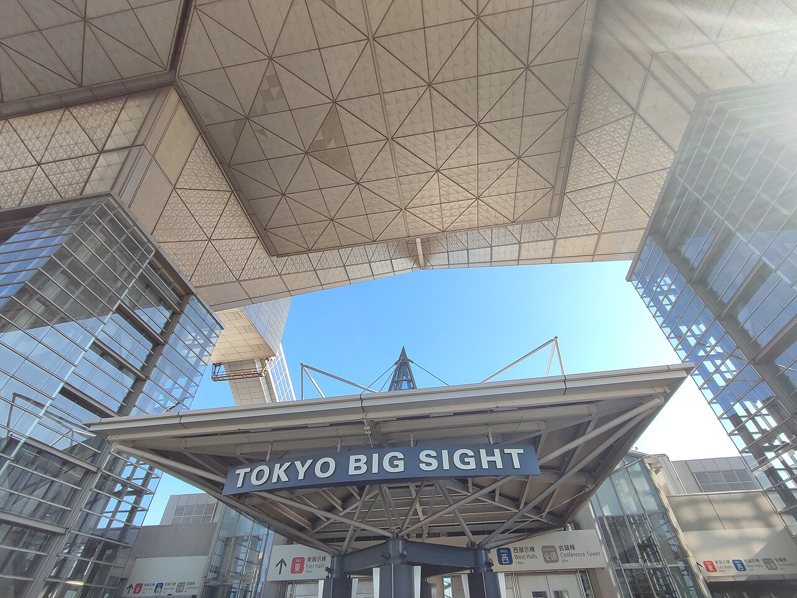

准备去东京看通信技术设备，最容易漏掉的不是展期，而是登记期限。COMNEXT 2026在12月2日至4日举行，但官方公布的免费登记截止日是11月24日。已经确定出差的人，应先完成身份登记，再慢慢筛选展商，不必等到行程完全排好才处理入场手续。

## 先锁定日期、展馆与登记成本

[COMNEXT官方首页](https://www.cbw-expo.jp/ja-jp.html)列明，本届会场是东京Big Sight西展示栋，开放时间为每日10:00至17:00；11月24日前登记免费，之后登记费用为含税5,500日元。这里的期限指来场登记，不是机票预订，也不是所有讲座的统一截止时间。

建议把登记确认邮件与日历事项放在一起，另标记“东京Big Sight西馆”。如果还安排其他东京展会，不要拿上一场的胸卡或展馆记忆套用。把邮件转给同行者也不等于替对方完成登记，出发前应各自核对姓名和收到的凭证。

*2024年2月东京国际展示场外观，非2026年展会现场、入口或排队示意。摄影：Masahiko OHKUBO；[Wikimedia Commons来源](https://commons.wikimedia.org/wiki/File:Tokyo_Big_Sight_exterior_2024-02-12.jpg)，[CC BY 2.0](https://creativecommons.org/licenses/by/2.0/)。采用Wikimedia提供的1280像素缩略图，未另行裁切。*

## 胸卡与讲座，是两件不同的事

按[官方来场指南](https://www.cbw-expo.jp/ja-jp/visit.html)，可以提前彩色打印来场者胸卡，也可使用兑换用二维码在现场设备打印；胸卡在三天会期内有效。打算连续两天参观的人，可保留好第一天的胸卡，不要离场后随手丢弃。

讲座需要另外申请。登记完成后，不应只把展会写进日历，还要检查希望听的场次是否已成功预约。实用做法是分开保存三项内容：入场凭证、讲座确认、展商会面记录。二维码截图只解决展示凭证的问题，不能证明讲座已经订好，也不能代替对方确认的会面时间。

如果以前参加过其他行业活动，可以对照[Inter BEE的登记与听讲区别](/blog/inter-bee-2026-registration-conference)理解这两层手续；具体规则仍以COMNEXT自己的确认页面为准。

## 不按热门词逛展，按待解决的问题选展商

本展涉及光通信、通信设备及网络相关技术。对于中文商务访客，行前准备不宜只有“想看看下一代通信”一句话。先写清自己是哪类需求：寻找可供集成的器件，改善既有网络，还是为工厂或园区比较通信方案。目标不同，需要见的技术人员和准备的资料也不同。

建议做一张简短需求卡，内容包括使用场景、现有接口、环境限制和希望确认的事项。数字只用可公开或获准分享的范围；不要把客户网络拓扑、账号、密钥或内部故障截图直接展示给陌生展商。用匿名示意图说明问题，通常也能开启有效讨论。

面对演示，先问“这套展示包含哪些设备和软件”，再问“现场效果成立需要哪些条件”。把演示环境与自己实际部署环境分开记录，比记下一个最高速度数字更有用。涉及日本以外的交付时，还应询问对应地区的支持窗口与资料语言，而不是默认日本现场销售人员能够覆盖海外项目。

## 给会面留出整理时间

可以把上午安排为重点技术沟通，下午用于补看展台与整理资料；这是行程建议，不是官方推荐路线。每次交流后记下对方承诺补发的材料、尚未确认的条件和下次联系对象，避免回国后只剩一袋名片。

第一次去大型会场，建议把第一场会面放在入场之后留有余量的时段。若还参加12月其他东京展会，可参考[SEMICON Japan的展馆与胸卡准备](/blog/semicon-japan-2026-venues-badge)，但不要假设两个活动共用登记。出发前再看一次官方通知，确认讲座、会场与接待安排是否变化。

信息核对：2026年11月18日。登记费用、节目和现场安排可能调整，以主办方最新页面及本人确认邮件为准。
