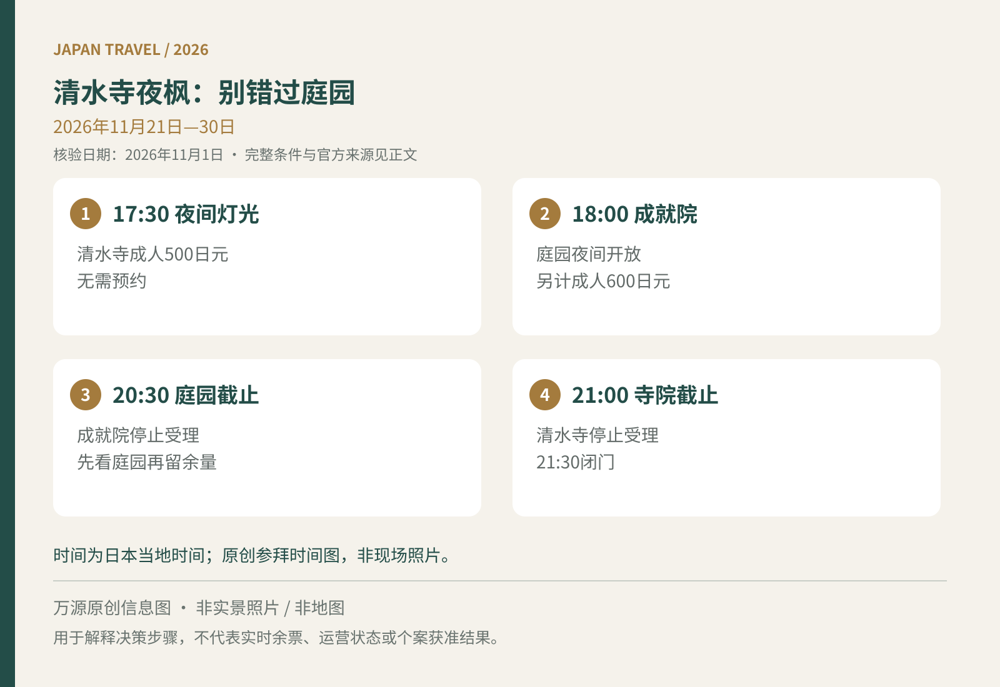

11月到京都，清水寺并不是整个月都能看夜枫。2026年秋季夜间特别参拜只安排在11月21日至30日；寺内的成就院庭园虽在同一段日期公开，开始时间、最后受理时间与费用却另列。想把两处都看完，应先安排庭园，再给本堂与下山留时间，而不是临近21点才到门口。

## 先核对十天会期，再决定几点上山

清水寺10月28日更新了秋季夜间参拜通知。寺方公布这十天延长开放至21:30，21:00停止受理，无须预约；京都市官方旅游页另列夜间灯光时段从17:30开始，成人500日元、小中学生200日元。21:30是离场边界，不是还能购票的时间。[寺方夜间特别参拜说明](https://www.kiyomizudera.or.jp/event/yakan.php)｜[京都市官方活动与票价](https://ja.kyoto.travel/event/single.php?event_id=3730)

如果旅行落在11月上旬或12月初，应把清水寺放在白天，不要借用去年的日期。寺方2026年开放日历列明，11月20日以前及12月1日起常规闭门时间为18:00。至于叶色，活动开幕并不保证已经全红，寺方也提醒每年见顷不同；出发前再看官方近况，比用日历推断满山红叶可靠。[2026开放时间](https://www.kiyomizudera.or.jp/access/)

<figure>
  
  <figcaption>万源原创时间对比图（AI辅助），非实景照片或地图；适用2026年11月21日至30日，完整费用与条件见正文。未使用第三方图像。</figcaption>
</figure>

## 成就院要另算时间，不能当作随手加一站

成就院“月之庭”适合愿意放慢脚步看庭园的人。寺方公布11月21日至30日白天10:00至16:00受理，夜间18:00至20:30受理，同样无须预约。京都市活动页列成人600日元、小中学生300日元，应与清水寺本堂参拜费分开预算；两处都参观，成人门票合计按1100日元准备。[成就院官方时段](https://www.kiyomizudera.or.jp/event/jojuin.php)｜[成就院官方旅游票价](https://ja.kyoto.travel/event/single.php?event_id=3761)

以两名成人加一名小中学生同行为例，只参观清水寺本堂，公布门票合计1200日元；若三人再看成就院，合计变为2700日元。多出的1500日元对应的是庭园体验，不是优先入场或缩短排队。预算有限时，保留最想看的一个区域，把省下的时间留给慢走即可。

只想看清水舞台与夜景，不必为了“来都来了”再赶庭园；喜欢庭园的人，则不要先在本堂附近拍到20:30再过去。建议把傍晚的一餐提前解决，入夜后集中参拜，结束再下山。这里的先后顺序是行程建议，不是园方规定的固定游线；实际仍按现场引导走，也不要把最后受理时间当成计划抵达时间。

## 白天东山散步可以接，跨城赶两个夜场不划算

一种从容安排是下午在东山街区散步，预留休息和上坡时间，再选择本堂夜景或“庭园加本堂”。若上午已经走了伏见稻荷、岚山等长距离路线，晚间就应减少附加项目。夜景的收益来自停下来观看，不是同一晚打卡寺院的数量。若当天需要寄存行李，应把取回地点放在返程路线内，并确认寄存处的营业时间；晚间闭门后再折返白天逛过的区域，会多消耗一次交通和体力。

住大阪的旅客还要反推回酒店的铁路与车站步行。清水寺闭门时间只约束参拜，不替你保证赶上列车。秋季东山巴士停靠和道路安排也可能调整，别只照旧游记寻找站牌；可先读[京都红叶路线与五条坂南行站提醒](/blog/d-20261009-063204)，把下山后前往哪座车站写清楚，再决定最晚离寺时间。

## 拍摄与同行体力，往往比门票更值得准备

清水寺官方禁止使用三脚架、独脚架及无人机拍摄，也要求不要长时间占据同一位置妨碍参拜与通行。夜间拍照尽量手持，停留拍好后让出位置；境内不允许边走边吃，能盖紧的水瓶或水壶是饮品规则中的例外。[清水寺参拜与摄影规则](https://www.kiyomizudera.or.jp/faq.php)

带婴儿车或轮椅同行，可提前查看寺方无台阶参拜路线。寺方说明本堂与境内有相应通路，但不提供轮椅借用；不能因此把二年坂、三年坂等周边台阶也视为无障碍。把“到入口”与“进入境内后怎么走”分开规划。第一次参拜也可参考[日本神社寺院与御朱印入门](/blog/b-20261011-090007)，让拍照、参拜与休息各有空间。

资料核验：2026年11月1日（日本时间）。本文未查询实时人流；会期不等于红叶见顷保证，临行前请复查官方公告。
