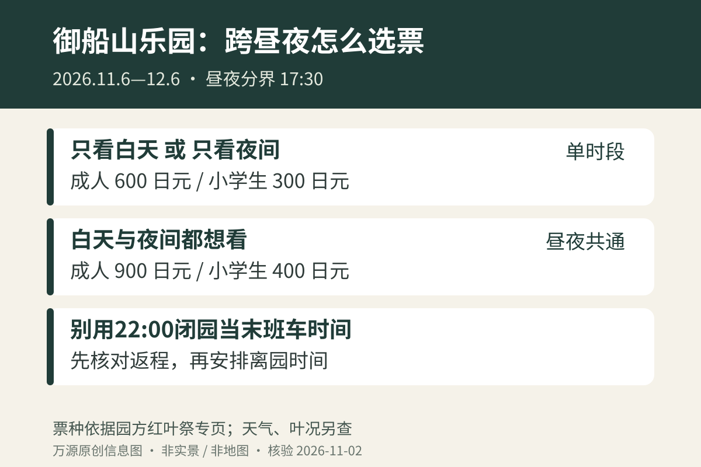

到佐贺武雄看红叶，御船山乐园适合两种节奏：白天看庭园层次，或傍晚到达后看池面灯影。如果希望从日落前一直逛到亮灯后，买票时就应说明要跨昼夜时段，别拿普通白天票预算整晚。2026年红叶祭已经公布安排，但活动开幕不等于全园树叶同时变红。

## 先把日期和昼夜分界记清楚

官方红叶祭为 **2026年11月6日至12月6日**，期间无休，雨天举办。白天开放8:00至17:30，夜间为17:30至22:00。不要把园方首页常规季节的500日元、17:00闭园直接套到红叶祭，活动专页另列了时段与票价。[御船山乐园2026红叶祭](https://www.mifuneyamarakuen.jp/autumn/)

只想看白天的人可选午前或下午的一段；想看夜景的人则先确认返程方式，再定到园时间。22:00是夜场结束时刻，并不意味着到22:00才出园还能顺利接上公交或列车。若后面有固定班次，应从车站发车时间往前倒推园门到车站的移动、候车和步行余量。

## 一家人怎样比较三种票

红叶祭单独白天或单独夜间，成人（中学生以上）600日元、小学生300日元；昼夜共通票成人900日元、小学生400日元。两位成人若确定跨昼夜，共通票合计1800日元，比按两场分别计算的2400日元少600日元。这是按公开票价做的算术比较，不包含餐饮、交通或其他设施。

*原创票种说明图，非门票样式；票价与条件以园方红叶祭页面为准。*

预算前先回答三个问题：同行儿童是不是小学生；是否确定要跨过17:30；是否符合园方列明的住宿客入园条件。园方仅明确御船山乐园酒店和竹林亭住客入园免费，不能扩大理解成“武雄温泉所有酒店住客免费”。未明确的幼儿或团体条件，应直接询问园方，不自行推定。

## 白天与夜间各留一个重点

园内有池面、坡道和大型树木，白天适合辨认景物的前后关系，夜间则更适合在允许停留的位置看灯光倒影。第一次来又想兼顾两者，可以把日落前的一段作为熟悉园路的时间；亮灯以后只回到最喜欢的一两个位置，不必在昏暗环境里再追一整圈。

御船山乐园并非平坦的城市广场。同行有长者、婴儿车或轮椅使用者时，应提前向园方确认可走范围及坡度，而不是凭入口历史照片中的轮椅判断全园无障碍。穿防滑、便于步行的鞋，把相机和手机操作留到站稳以后；雨天先缩短路线，不为了拍倒影靠近水边。

园方红叶祭规则禁止无人机航拍，也禁止携入蓝色塑料铺垫和酒类。拍摄时尽量短暂停留，避开主通道，别用三脚架或行李把其他人的路封住。这里的安排建议是为了游览便利，不代表园方承诺每条路线或每个拍摄点都开放。

## 住武雄还是当天返回，先处理最后一段交通

如果计划住在武雄，晚饭时间要和夜游拆开确认：住宿餐食、庭园入园与酒店其他设施不是同一项预约。想从福冈当天往返，则先在铁路官方渠道确认去回车次，再向当地交通运营方核对车站到庭园的当日接驳。不要拿白天公交频次推算22:00之后也有车。

可以把“下午到武雄、先吃饭或办理入住、傍晚赏园”作为安排框架，但实际顺序仍以个人车次和餐厅预约为准。若只能留一小时，选一个时段会比为了用完共通票而赶路更舒服。准备搭配温泉住宿，可先看[日本温泉旅馆一泊二食怎么订](/blog/b-20261009-063205)，避免晚到错过晚餐。

最后再次区分：**红叶祭会期、每天开放时间、当日叶况**是三件事。官网往年照片和天气网站的预计见顷都不能作为11月2日现场实况。订不可退交通前，保留雨天和叶色未达预期时的替代安排。

*信息核验日期：2026年11月2日（日本时间）。本文整理已公布安排，不代表实时叶况、余票或当天运行状态；临行前请复核官方更新。*
