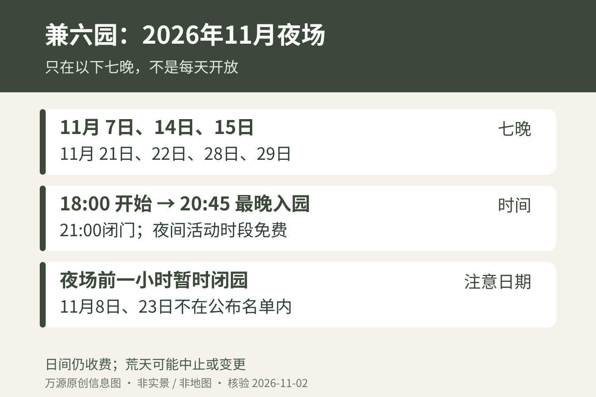

金泽11月旅行如果想看兼六园夜景，先在住宿日历上圈出活动日，再安排晚餐。2026年“秋之段”不是整月每天延长开放，也不是逢周末两天都开：11月第一周只有7日，三连休的23日也不在公布名单里。订好夜间行程之前，日期比预计红叶颜色更值得先核对。

## 2026年11月只有这七晚

官方公布的11月活动日为 **7、14、15、21、22、28、29日**。该月夜场18:00至21:00，最晚入园20:45；夜间活动时段入园免费，日间参观仍按普通收费规则办理。9月已经结束的秋之段不能和11月拼成连续会期。[兼六园观光协会：秋季灯光](https://kenrokuen.or.jp/events/lightup-2609/)

若你住在金泽的日期是11月8日、23日或某个工作日，就不要只看“11月夜枫”四个字订晚饭后的入园安排。可以保留白天庭园，夜晚另选城市散步；为了看夜场调整住宿，也要同时比较改订成本和交通时间，而非只看免费入园。

*原创日期图，红色日期仅表示公布的夜场日，不是实时叶况或天气保证。*

## 白天逛到傍晚，不能直接留在园里等亮灯

石川县官方活动页明确，夜场开始前一小时会为准备工作暂时闭园。因此白天与夜间应当作为两段行程考虑。可以把中间空档用于早晚餐或短暂休息，但需先确认餐厅营业与位置，不要在准备时间里等着原地亮灯。[石川县2026秋之段公告](https://www.hot-ishikawa.jp/event/detail_22163.htm)

如果晚饭预约在19:00，18:00才进园可能过于赶；可以先吃饭、再入园，或把晚饭放在赏园之后并确认厨房最后点单时间。20:45只是入园截止，并不是建议到达时间。需要慢走、拍照或照顾同行长者的人，建议提前留一段完整的夜游时间，而不是为了省门票而压缩到最后十几分钟。

## 雪吊是保护树枝的结构，不是下雪预报

11月进入金泽的“雪吊”季节：工匠用绳索支撑枝条，帮助树木承受日本海侧较湿重的积雪。金泽官方介绍，兼六园相关作业通常从11月1日持续至12月中旬。由此不能推定11月初每棵树都已完工，更不能把看到雪吊等同于当天一定有雪。[金泽官方：雪吊作业](https://visitkanazawa.jp/en/spot/detail_50425.html)

想看红叶与绳索轮廓同时入画，可将其当作晚秋庭园的一种观察主题，不要追求与历史照片完全相同的颜色和布局。正文封面为2013年11月的历史照片，用于说明庭园及支撑结构，不是2026年夜间灯光实况。若目标是看工匠工作，另查当天作业安排，不能凭晚间灯光开放推定夜里也施工。

## 夜间只走开放区，演奏会另看具体日子

官方提示园内、桥上避免使用三脚架，部分区域夜间不开放，应跟随当天标识。喜欢拍照的人可以先看好取景再短暂停留，不要为了长曝光挡住桥面。照明会改变对台阶和水边高差的判断，手机屏幕亮度调得太高也容易让眼睛忽略脚下。

夜场期间有部分日期安排演奏，不是七晚同一节目。若音乐是专程来访的重点，查活动页的演出日期、开始时间及观赏位置；若只是看庭园，就不必为了赶一场短演出反复横穿园路。灯光、演出、餐饮店开放是不同信息，需要分别确认。

## 把夜场放进金泽行程，而非硬加第三段奔波

从金泽站出发可查到兼六园下・金泽城一带的公共交通；返程要按实际离园时刻查班次，白天高频路线的印象不等于晚上仍有同样频次。下雨或风大时，官方可能调整或取消活动，出发前再查更新。

两天游览可参考[金泽两日游分区安排](/blog/d-20261012-090005)，把兼六园附近的白天项目与夜场放在同一天，减少跨城折返。若同时安排[金泽11月吃蟹](/blog/d-20261025-090006)，先确定更难调整的餐厅预约，再在七个夜场日期中选合适的一晚。夜间免费值得利用，但不应成为把一整天排得无法休息的理由。

*信息核验日期：2026年11月2日（日本时间）。本文整理已公布安排，不代表实时叶况、余票或当天运行状态；临行前请复核官方更新。*
