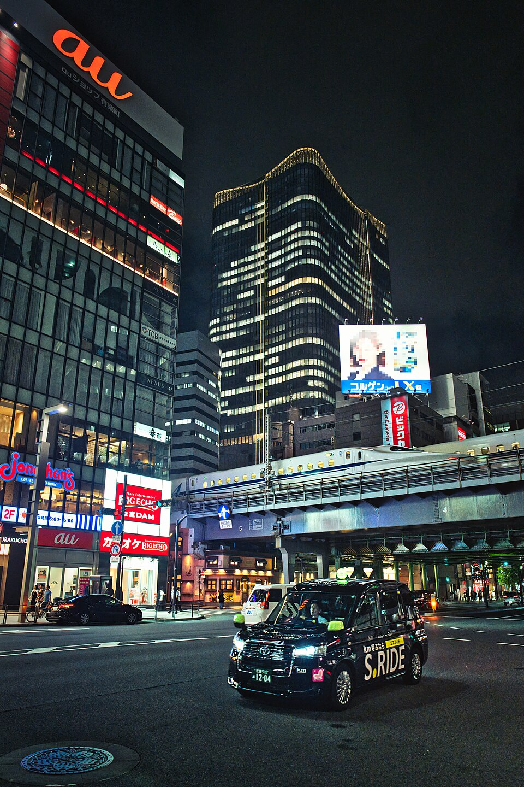

年底到东京，如果想在晚餐或看电影之后加一段灯光散步，日比谷比跨城追大型灯展更容易融入行程。2026年的HIBIYA Magic Time Illumination横跨圣诞与新年，不过“整体办到2月底”不代表每个布景都留到2月底。选日期时，先区分广场主树、仲通街道灯光与六楼庭园。

## 先认地点：这里是日比谷，不是六本木

本篇地点是 **Tokyo Midtown Hibiya，东京都千代田区有乐町1-1-2**。它与六本木的Tokyo Midtown、东京站附近的Midtown八重洲是不同设施。手机地图里只输入“Midtown”，容易得到与今晚安排不一致的地点；和同行者会合时最好写完整英文名及“日比谷”。[日比谷设施地址与交通](https://www.hibiya.tokyo-midtown.com/jp/access/)

官方交通说明为东京地铁千代田线、日比谷线及都营三田线日比谷站直结；JR有乐町站步行约5分钟，东京地铁有乐町站约4分钟，银座站约5分钟。步行参考不包含所有站内移动。选车站以酒店所在路线与电梯需求为主，不必为省一两分钟在大站多换一次线。

*2024年8月22日的建筑与街区环境照片，仅供辨认Midtown日比谷，不是2026圣诞灯光陈设或指定步行路线。摄影：[brian25_tw](https://www.flickr.com/people/108095423@N05/)；[Wikimedia Commons来源](https://commons.wikimedia.org/wiki/File:Tokyo_Midtown_Hibiya_and_Shinkansen_at_night_-_Aug_22,_2024.jpg)，[CC BY-SA 2.0](https://creativecommons.org/licenses/by-sa/2.0/)。使用Commons官方960像素宽缩略图、下载字节未改；来源版本已对广告屏打码，本次未另改内容。图片继续采用CC BY-SA 2.0。*

若本来想去六本木，请改看[东京Midtown六本木2026圣诞灯光](/blog/b-20261021-090001)；两地开幕日期不同，别把一处的宣传图、休馆信息套到另一处。

## 11月12日开幕，但电影主题主树只到圣诞节

官方活动总期为 **2026年11月12日至2027年2月28日**，公布点灯时段16:00至23:00，范围包括日比谷Step广场、六楼Park View Garden及日比谷仲通。各区实施期不同，其中以《复仇者联盟：毁灭之日》为主题的电影主题主树，公布展示期仅为**11月12日至12月25日**。[日比谷2026活动官网](https://www.hibiya.tokyo-midtown.com/jp/event/7587/)

如果特地想看主树和广场的电影主题光影，应把到访放在12月25日或之前，并临行再查实际开放。12月26日以后到东京，也不必因此取消日比谷夜游：街道灯光与六楼庭园仍在公布的冬季活动期内，只是看到的内容不完全相同。

主办方10月29日的新公告进一步说明，仲通灯光分成两段：11月12日至12月25日为金色与琥珀色为主的“GOLDEN HOUR”；12月26日至2027年2月28日换成以午夜蓝并配紫、粉、白色的“MIDNIGHT BLOOM”。这是今年明确公布的换色安排，不能用上一季照片判断哪天一定是什么颜色。Step广场大阶梯上的ETERNAL HEART TREE与HEARTFUL BENCH也公布延续至2月28日，因此圣诞后并非整个广场都熄灯。[主办方2026灯光分期公告](https://prtimes.jp/main/html/rd/p/000000096.000122345.html)

## 用一个小时还是一整个晚上，路线怎样取舍

只有一段短时间，可以把地面Step广场与仲通作为主线，走完后就返回车站；想同时看城市夜景，再加六楼Park View Garden。六楼是室外庭园，不能把它当作下雨时的完全室内替代。遇风雨或孩子觉得冷，缩短户外停留，比为完成清单不断换楼层更舒服。

一套建议节奏是：先在日比谷或有乐町附近用餐，随后看地面广场，再视体力上六楼，最后沿仲通往返程车站方向走。另一种适合较早结束白天行程的做法，是16:00后先看一轮，再去已经确认的餐厅。这里的时间是排程建议，不是官方演出场次，也不保证固定时刻人少。

灯光观赏没有在现有活动页列出收费票种或日期预约入口，通常可作为街区散步安排；餐饮、电影、购物及其他独立体验另计。不要因为想看户外灯光，就误买名称相近的市集或付费展望台产品；如果临近到访出现特别活动收费，应以该活动新公告为准。

## 想买圣诞手作，别把市集当成每天都有

主办方公布B1日比谷Arcade的圣诞手作市集，计划在12月19日至21日、23日至25日举行，12:00至19:00；**12月22日不在这两段日期内**。灯光从11月就开始，不能据此认为地下市集也从11月天天开放。想购物的人，先锁定市集日期，再把户外灯光放在同一晚。[主办方市集分日安排](https://prtimes.jp/main/html/rd/p/000000096.000122345.html)

若11月或12月上旬到访，则以灯光、餐厅与常设商店为主，不需要为尚未开始的市集留出购物时段。反过来，12月末入住附近的人可以看换色后的街道灯光，但不要再期待圣诞主树与手作摊位同时保留。

## 带长者或婴儿车，留意服务时间比灯光短

设施无障碍页说明，一楼问讯处提供轮椅借用，时间为11:00至19:30，且必须在19:30前归还，只限Midtown日比谷设施内使用，不接受预约。依赖现场借用轮椅的游客，应将归还时刻写进计划，不能因为灯亮到23:00就把轮椅也用到23:00。[日比谷无障碍服务](https://www.hibiya.tokyo-midtown.com/jp/service/hcp/)

带婴儿车者优先查看楼层图与电梯指引，不把大阶梯当成必须经过的打卡路线。拍照时把包与车停在不阻挡通道的位置；晚餐店铺的最后点单、商店营业和车站末班分别核对。官方常规商店时段到20:00，也不能根据灯光时间推断所有店都营业到深夜。[设施交通与营业提示](https://www.hibiya.tokyo-midtown.com/jp/access/)

如果还想延伸到东京站，先对照[丸之内2026灯光分期开幕安排](/blog/d-20261031-110004)，再按天气与步行体力决定是否增加街区；拍夜景的准备，可参考[日本夜景与拍照注意](/blog/b-20261015-090009)。
