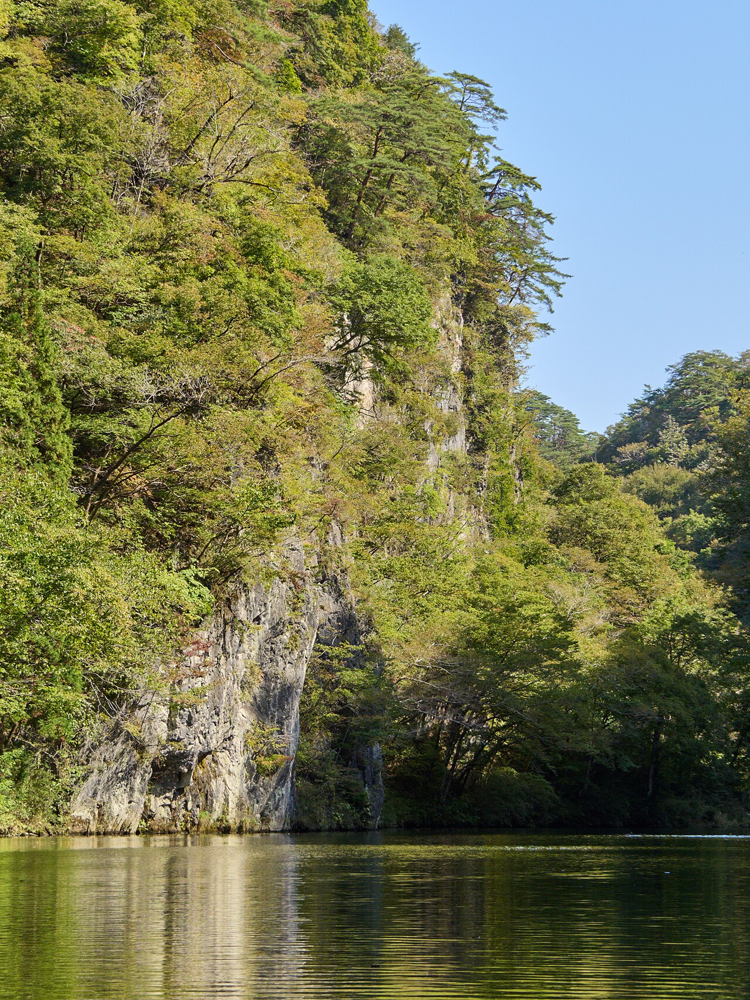

从岩手一关出发，猊鼻溪可以当成一个把速度放慢的冬季半日：先乘船向上游走，靠岸后在谷里下船，再沿原河道回去。**“舟下り”这个名字容易让人误以为船只走单程；实际上，这里的观光船往返约90分钟，出发和结束是同一个码头。**不需要让家人开车绕到下游接，也不用把背包留在另一处车站。[东观联猊鼻溪项目说明](https://www.tohokukanko.jp/attractions/detail_100120.html)

*猊鼻溪岩壁与河面历史照片，拍摄时间仅知在2026年3月29日前；并非冬季暖桌船或实时雪况。作者[lumoplank](https://www.flickr.com/people/lumoplankter/)，[图片来源](https://commons.wikimedia.org/wiki/File:Geibikei_-_Geibikei7677.jpg)，[CC0 1.0](https://creativecommons.org/publicdomain/zero/1.0/)。使用Commons提供的1280像素缩略图，未另作裁切或修改。*

## 想坐暖桌船，别只看屋形船的起止日

东北观光机构列明，11月21日至翌年3月31日为有顶屋形船，**12月1日至2月底这一段才是暖桌船季节**。先分清「屋形船」与「こたつ舟」，11月下旬看到有盖船也不必期待脚边已有暖桌。运营方的通常冬季时刻表为9:30、10:00，之后11:00至15:00每个整点一班；遇荒天可停运，繁忙时也可能有增班。把它当计划表，不当现场座位保证。[运营方路线与费用](https://www.geibikei.co.jp/route)

地方观光信息列出普通成人2000日元、小学生900日元；运营方幼儿档为3岁起200日元。15人及以上需要按团体规则预约。另有「木流し鍋」等餐食，官方明确要预约，普通乘坐暖桌船不等于已包含餐食，也不意味着可以临时上船加点；想吃锅就先问清人数及能订哪班。不特意订餐，照样可以去看峡谷。[一关市猊鼻溪说明](https://www.ichitabi.jp/spot/data.php?p=1)

## 岸边停留也是体验的一段

这里值得看的不只有雪：船在高岩之间转向时，视角从水面贴近岩壁，返程又能从另一方向看到同一块岩石。船夫以长篙撑行，当地舟歌是路线特色。途中靠岸时，如步道开放且脚下状况允许，可以下来看看；带长辈时别把船上暖桌理解为全程不用站起或不出屋面。需要无障碍安排，先联系运营方说明登船、轮椅及上岸需求，不只问“有没有无障碍船”。

戴手套并穿防滑鞋，不是为了去走复杂山路，而是冬季码头、湿地和上岸段都可能有冷风与湿滑地面。景色也不依赖一定下雪：此行可以以峡谷与船行作主目标，不为了追雪在登船前加远处景点。打算调整难度时可参考[带长辈旅行的步行与休息检查](/blog/b-20261009-063208)。

## 先把一关方向的下一班存下来

一关市给出的参考路线是从JR一ノ関站乘大船渡线约30分钟到猊鼻渓站，步行约5分钟到乘船处。一ノ関是站名，不要只在搜索框里用城市的一关汉字。列车过来的时刻和船表是两家各自安排，不能默认对接。选好船班后，加上步行、售票和候船；反向则从计划发船时刻加约90分钟，再看能不能从码头从容走回车站。贴得太紧就选晚一点的铁路班次，或早一班船。

举个倒推例子：若选13:00的普通船，按90分钟估算约14:30回到乘船处；即便地图步行只要五分钟，也不宜用14:35离站的假设订下后一段交通。这个例子不是铁路班次推荐，只说明还须给上下船、整理衣物和过路留时间。若希望回一关后继续搭新干线，最好同时存下大船渡线下一班与后一班新干线的选择；不必到了谷里信号不稳时才从头查。

地方官网提示东磐交通本地巴士年末年始有休运，不能想当然把公交当铁路的即时补位。行程只有半天，可把午饭放到一ノ関站附近，谷中以船为主；若原计划还要去平泉或仙台，请先确保后半段的列车，再加景点。继续去仙台可从[仙台市区和松岛的一日取舍](/blog/d-20261015-090004)另选一天。资料核查于2026年11月22日，具体当天班次、道路及船况以运营方为准。
