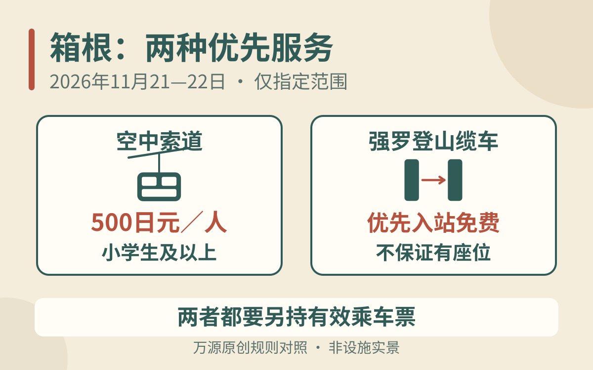

计划**2026年11月21日或22日，从强罗、早云山方向前往大涌谷和芦之湖**，可以考虑箱根索道此次付费优先通道。预约在**11月13日18:00日本时间（中国大陆17:00）**开放；如果从桃源台反向上山、在23日游览，或只去强罗，这项预约并不对应你的路线。[小田急箱根11月4日公告](https://www.hakonenavi.jp/_wp/wp-content/uploads/2026/11/12f4caecbe206dea75e6bcfa05b40804-1.pdf)

先确认日期与方向，再决定是否预约。500日元是优先改札费用，乘车所需的有效车票仍要另外准备；它也不覆盖整条箱根环游线的所有排队。

## 两种交通、三个预约位置，先分清

中文常把箱根的两种交通都叫“缆车”：强罗至早云山是沿轨道行驶的登山缆车（ケーブルカー）；早云山经大涌谷往桃源台是空中索道（ロープウェイ）。本次两者都有优先安排，但费用、预约方式与适用班次不同。

| 交通与预约站 | 适用方向 | 11月21、22日的安排 | 优先服务费用 |
| --- | --- | --- | --- |
| 空中索道：早云山 | 早云山→大涌谷 | 11:00–15:00，每15分钟最多100人 | 小学生及以上每人500日元 |
| 空中索道：大涌谷 | 大涌谷→姥子、桃源台方向 | 11:00–16:00，每15分钟最多100人 | 小学生及以上每人500日元 |
| 登山缆车：强罗 | 强罗→早云山 | 11:03、12:03、13:03、14:03发车，每班30人 | 免费，但仍须有乘车票 |

以上为[箱根官方预约说明](https://www.hakonenavi.jp/topic/17737/)公布的范围。大涌谷往早云山方向、姥子站和桃源台站不实施这次索道优先改札；登山缆车早云山站也没有对应安排。

<figure>
  
  <figcaption>原创规则对照，非设施实景或车票；只适用于正文列明的11月21、22日指定站、方向、班次及预约规则。 万源原创图示（AI辅助）。</figcaption>
</figure>

因此，住芦之湖一带、先从桃源台去大涌谷的人，不应为了“500日元优先”预订一个相反方向。要不要走整圈，仍可先按[箱根一日游与住一晚的路线取舍](/blog/d-20261010-090002)决定，再预约真正会经过的站点。

## 索道预约：13日开约，到站出示凭证并付现金

从[箱根导航本次活动页](https://www.hakonenavi.jp/topic/17737/)进入，按所需乘车站选择日期、时段与人数。索道每组最多5人，先到先得，达到名额即停止受理。公告列的是预约容量，不是当前剩余名额；本文没有查询实时库存。

当日到对应站的改札口，向工作人员出示预约画面或打印的预约票，并以现金付款。可以把车票与优先预约分别放好：前者用于乘车，后者用于核对这次优先服务。已有周游券的人，也应核对其覆盖区间与有效期，不要把“有通票”理解为已预约优先改札。

一家人同行时，小学生并不享受本次优先费的儿童半价。带学龄前儿童，应按预约页面要求填写同行情况；不要只登记付款人数，就自行认定所有同行者都已被包含。若人数超过5人，先查看开约后的办理说明，不要把不同订单或不同时间段当成必定可以整组同时通行。

若准备在早云山与大涌谷两处使用，分别核对所选站和预约记录。官方按乘车站受理，不能把一张预约画面当作全程、往返通用的优先凭证。

## 强罗免费预约已经另行开放，优先入站不保证座位

强罗登山缆车的预约在11月4日14:00已经开放，入口是官网链接的[强罗优先改札预约网站](https://hakone-tozan.stores.jp/reserve/hakonetozan-cablecar)。它并非等到索道11月13日开约才一起开始。[官方新闻稿中的登山缆车说明](https://www.hakonenavi.jp/_wp/wp-content/uploads/2026/11/12f4caecbe206dea75e6bcfa05b40804-1.pdf)

完成预约后，按指引前往强罗站内集合位置。预约者先进入站台，再让一般旅客进入；运营方明确说明**不确保座位**。如果同行长者必须坐着乘车，不能只凭这一项预约就认定需求已经解决，应事先向运营方询问适合的安排。

这项预约只处理强罗登山缆车的入站，不会替你把早云山的索道预约好。两个网站或订单中出现不同名称时，先认交通工具与出发站，不要只找中文里的“箱根缆车”四个字。

## 怎样衔接，才不会为了预约一路赶路

假设你从强罗出发，想在大涌谷游览后往桃源台：先确定登山缆车班次，再预留到早云山后的换乘、步行与手续时间，之后才选索道优先时段。抵达大涌谷后若要吃饭、散步或购物，应把这些时间算在第二段预约之前。

不要把强罗发车时刻和早云山索道预约安排得几乎重合，也不要为了连着两段优先通道，把大涌谷停留压缩到只够拍一张照片。本次公告没有给出一个适用于所有人的“安全换乘分钟数”，也没有承诺迟到后可顺延；具体集合时间、迟到或改时办法须看最终预约确认。

若下午还要赶回温泉旅馆吃晚餐，先以旅馆要求的到店时间倒推最后一段交通，再决定是否加入芦之湖。订房时还没确认晚餐截止的，可参考[温泉旅馆一泊二食的交通与供餐检查](/blog/b-20261009-063205)。优先服务可以作为行程中的一个选项，不应成为增加景点、取消时间余量的理由。

## 没约到、要取消，或当天停运怎么办

索道公告注明取消免费；需要调整时，从原预约入口查看操作方法，别把取消优先预约误当成所有车票与住宿也已取消。普通乘车票、周游券及其他预订，各自适用原渠道的条件。

没有优先预约，仍可在正常运营时按普通队列候车。若现有路线时间充裕，可以保留普通乘车方案，不必因为预约额满就认定这两天无法坐索道。

天气等原因造成停运时，两种优先预约均失效。出发前与准备上山时，查看[箱根官方运行与拥挤信息](https://www.hakonenavi.jp/transportation/)，分别确认登山电车、登山缆车、索道及船的状态。当天若改坐巴士，应重新查线路、站点和运行情况，不把其他交通自动当成无等待的替代；付款与乘降可先看[日本市内公交与箱根登山巴士乘车方法](/blog/b-20261103-090006)。

**资料核验：2026年11月12日。** 本文依据此次两日试行公告，不将它当作全年常设服务，也不承诺免排队、节省固定时长或取得座位。预约与具体运行以官方当日说明为准。
