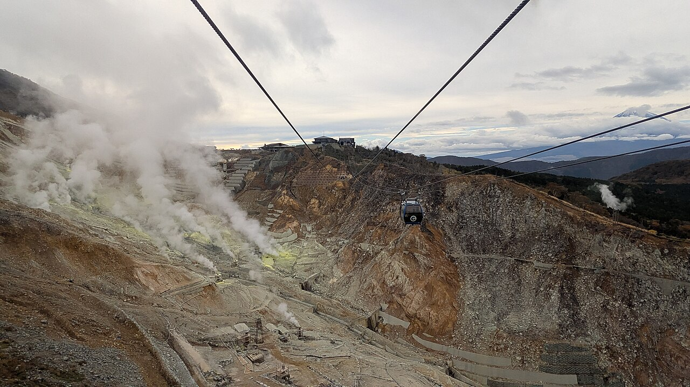

箱根冬季索道不是一口气全线停掉。根据小田急箱根[简体中文检修公告](https://www.hakonenavi.jp/international/cn/wp-content/uploads/sites/4/2026/09/5a5775b6d25bc2d6d8d57efb9bf9b190.pdf)，正常四站依次为早云山、大涌谷、姥子、桃源台，停运分两次。12月从强罗一侧上来的游客与次年1月从芦之湖反向过来的游客，不能套用同一组换乘步骤。核验日期为2026年11月26日。

地点参考，非本届施工或实况。摄影：[Joli Rumi / Wikimedia Commons](https://commons.wikimedia.org/wiki/File:A_view_of_Owakudani_and_ropeway,_Hakone,_Japan4.jpg)，[CC BY-SA 4.0](https://creativecommons.org/licenses/by-sa/4.0/)，复用本站原等比缩图。

## 12月7日至24日：先在早云山换巴士

这18天，早云山—大涌谷停驶，桃源台经姥子到大涌谷的另一侧按计划仍由索道行驶。从强罗搭登山缆车来的旅客，到了早云山先找箱根空中缆车代行巴士，而不是排在普通吊厢入口等。若天气和同行体力许可，可到大涌谷再决定是否继续去桃源台；只为在芦之湖一侧体验一段吊厢，没有必要把早云山一侧也硬排进去。

## 1月12日至2月26日：换成桃源台一侧检修

这一段是大涌谷经姥子至桃源台，早云山—大涌谷按计划仍行索道。住在芦之湖附近的人，应把桃源台的代行巴士放进行程，不默认在姥子有与原索道相同的中间站服务；需要姥子上下车时先核实际巴士停靠。两个停运时段以外也不能保证吊厢照常，风等临时因素另看[运营方实时信息](https://www.hakonenavi.jp/)。周游券有效范围与索道能否运行是两件事。

## 给接驳留空档，不按缆车时间赶下一班

运营方说明，可凭箱根周游券等有效索道票搭公布的代行巴士，但也提示车内及道路可能拥挤。公布的车程不是排队加步行总时间，不把轮船、索道、餐厅预订或返回小田原的指定席放成连续无缓冲的转乘。带推车、轮椅或大箱者，先查巴士的上下车和空间条件，自备中途退出方案；只想看大涌谷也可不跑完整环线。最后把出发站及方向与施工日期对照，提前决定当日不得不删掉的一站。

延伸阅读：[天气不合适时的箱根亲子备选](/blog/hakone-open-air-museum-winter-family-2026)；[此前优先通道试行不是冬季检修安排](/blog/hakone-ropeway-fastlane-2026)。
