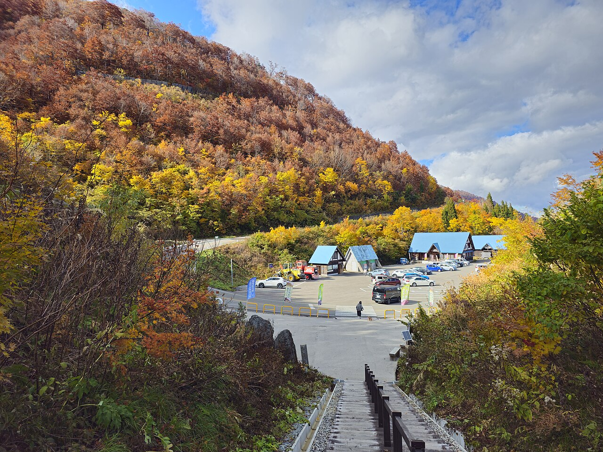

计划2026年11月中旬从金泽去白川乡，若行程里写了“白山白川郷ホワイトロード”，现在就要重排。道路运营方公告：**石川县与岐阜县之间经这条道路的穿越通行到11月10日为止，11月11日起有料区间冬季关闭**。[白色公路实时通行公告](https://hs-whiteroad.jp/news/)

受影响的是这条山岳观光道路。白川乡集落、金泽市区和两地之间的其他交通，并不能由这个公告一并判定关闭。先辨认原行程究竟走哪条路，再决定删景点、改交通还是改住宿。

## 先把“穿山看景”和“到白川乡”分开

White Road常被译为白色公路或白山白川乡白色之路，连接石川与岐阜，沿途停靠和山景本身就是游览内容。运营方问答说明，经它从金泽到白川乡，比使用东海北陆自动车道的路线花费更多时间。[运营方道路性质与季节问答](https://hs-whiteroad.jp/faq/)

因此，两种订单看起来都写“金泽到白川乡”，实际可能完全不同：一种是直接前往合掌集落，另一种是途中游山、看瀑布再越岭。确认交通时，应把道路日文名与希望停靠的景点发给安排方，而不只问“白川乡还能去吗”。

如果原计划的重点是集落，通常应先研究其他正常开放路线；如果期待的是白色公路沿途景观，那些停靠点本身就需要取消或另择季节。改走高速公路，不能同时承诺原山路景点全部保留。

万源场所参考｜P11白川乡展望台停车场，2025年11月6日实拍，非2026年叶况或当前通行状态。 摄影：[Sanjo](https://ja.wikipedia.org/wiki/User:Sanjo) / [Wikimedia Commons](https://commons.wikimedia.org/wiki/File:Hakusan_Shirakawa-go_White_Road_P11_20251106.jpg)，[CC BY-SA 4.0](https://creativecommons.org/licenses/by-sa/4.0/)。使用Wikimedia Commons提供的1280×960等比缩小版；完整构图，无裁切、调色、叠字或内容修改。

## 11月10日也不是全天无条件可通行

运营方现行说明，9月至11月通常8:00至17:00可从收费站进入，18:00闭门；遇积雪或路面冻结可能临时停止通行。[官方入场与闭门时间](https://hs-whiteroad.jp/faq/)

准备在11月10日最后一天尝试的人，应先查看当晨通行状态，不能只依据年初营业日历。17:00是进入收费区的截止，不是“此时才从金泽出发”或“还能慢慢看每个停靠点”的保证。天气有变就删去山路，不在封路门前等待工作人员放行。

本文也不把翌年的重开日写成确定日期。运营方只说明通常在6月上旬至中旬视积雪情况恢复，具体日期需等正式公告。尤其准备黄金周自驾的人，不能因已经是春天便推断这条路可通行。

## 已订包车或自驾，按停靠点重算行程

拿出原订单，把内容分成三栏：酒店与车站、白川乡集落、白色公路区间景点。先删除落在关闭区间的停靠，再让运营方说明替代路线、预计车程及费用是否变化。通行费、总服务时长和上下车地点都应按新安排确认。

例如原先打算上午离开金泽，在山路看景后下午到白川乡，改线后可能多出市区或集落停留时间。可以把这段时间用于午餐与慢走，不必马上再添一个远处景点，把冬季道路上的余量重新耗尽。

若今晚住石川、明晚住岐阜，检查两家酒店的晚餐和最晚入住时间，再确认改线可行性。已经订好一泊二食的人，尤其别只问“最终能到”，还要问能否在用餐受理前抵达。需要基础订房核对，可参考[温泉旅馆一泊二食怎么订](/blog/b-20261009-063205)。

## 无车旅客可查金泽出发的预约巴士

北陆铁道仍提供**金泽至白川乡、高山方向的高速巴士线路与预约入口**，金泽出发部分标注为预约制。它是重新规划交通的官方查询起点，不应因为观光山路闭季而直接认定所有巴士停运。[北陆铁道白川乡・高山线](https://www.hokutetsu.co.jp/highway-bus/takayama)

先查到访当天去程与回程是否都有合适席位，再决定集落停留长度。单程订到车不代表晚上一定能回原酒店，也不能把各地出发的不同运营线路混为一张可随意换乘的通票。本文未查询实时余票，不承诺临时到站能上车。

同一官方班表中，带星号的五箇山菅沼停靠只适用于4月至11月。若把旅行推到12月，要重新检查该站是否仍停，不沿用11月“顺路多看一个村落”的安排。这里说明的是该线路的停靠条件，不是整个五箇山地区关闭。

## 白川乡停车新制，是另一件要确认的事

12月到访并使用旅游巴士车位的人，还涉及白川乡停车预约。它与11月白色公路闭季分属两项规则：一个决定车辆可走的道路，一个决定到达集落后能否按计划停靠。

跟团游客可以请运营方一次确认“实际路线、车辆类别、停车预约、集合地点”。普通小客车也应查自己的停车办法，不能只因为商品名称叫包车，就套用旅游巴士规则。详见[白川乡12月巴士停车预约新规](/blog/d-20261026-090001)。

## 出发前保留三条信息

- 保存运营方当天通行公告，确认白色公路没有被旧导航重新选入路线。
- 保存实际交通订单和返回住宿的安排，说明有哪些停靠已删除。
- 遇临时降雪或其他道路管制时，先减行程，再调整到达时间，不要求司机赶路补回。

若打算把金泽市区留作替代游览，可从[金泽两日游的分区安排](/blog/d-20261012-090005)选择一个重点。封闭公告要读到具体路段，冬季计划也要落实到实际交通，不把“景点还开放”和“原路仍能走”当成一回事。

信息核验：2026年11月10日。本文不保证其他道路或巴士在恶劣天气下照常通行。
