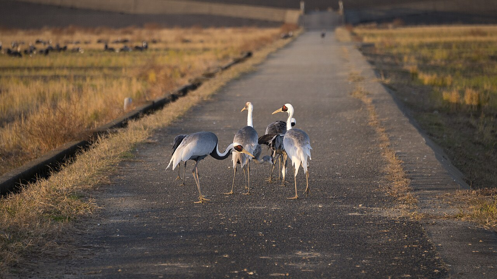

冬天去鹿儿岛县出水看鹤，最值得先选的不是相机焦距，而是要不要赶清晨。看晨光里飞过湿地的鹤，要接受起早、户外等待以及调查日的限制；第一次去，只想看群鹤觅食和读懂展板，白天到观察中心反而更从容。**出水本季越冬区利用管理从2026年11月1日至2027年3月14日，公布时段6:30至16:30，清晨开放并非每天都一样。**[出水市本季公告](https://www.izumi-navi.jp/news/post-4378/)

鹿儿岛县出水越冬地的白枕鹤，摄于2024年12月19日。为历史实拍，不代表2026年当日数量，也不能用照片中的小路判断哪里可以进入。 [White-naped cranes](https://commons.wikimedia.org/wiki/File:White-naped_cranes.jpg)／[The Modern Polymath](https://commons.wikimedia.org/wiki/User:The_Modern_Polymath)／Wikimedia Commons／[CC BY-SA 4.0](https://creativecommons.org/licenses/by-sa/4.0/)。使用 Commons 提供的 1280 像素版本，未另裁切或调色。

## 先分清6:30与9:00，再决定是否早起

12月5日、6日、19日及2027年1月16日、17日列在羽数调查相关日程中，包括候补日；主办单位提示这些日期按9:00前不能进入利用管理区准备，再查当日是否调整。并不是从这几天推算每周周末都晚开；也不要把调查日当作可围观调查过程的早场。越冬区6:30的通常安排也不等于观察中心室内已开门，**中心本身9:00至17:00开放，16:30停止受理入馆。**带孩子或怕风的人，可以优先选择室内服务已开始的时间。[观察中心时段](https://www.izumi-navi.jp/spots/post-953/)

若一定要拍天亮前后的变化，先确认拍摄位置确实在允许区域和时间内，再查交通。清晨常规行程只意味着能在指定地点等待，不保证群鹤从相机前一起起飞，也不代表某天必定有同样数量。遇到对象暂离视野，就观察湿地或等待，不在农路上追随鸟群。

## 第一站固定：到观察中心领入域凭证

按湿地官方流程到**出水市鹤观察中心**停车场，向工作人员缴环境保全协力金并领凭证。普通自驾小客车按一日一车1000日元；出租车、二轮和步行同列于公告的“普通车以下”类别，按所选到达方式现场确认，不把费用一律摊成每人车费。凭证出示后可免费进入观察中心，公告也列有双筒望远镜等可借用；实际供应需现场询问。使用指定路径，按工作人员指引配合车辆和鞋底消毒。[湿地参观流程](https://www.ramsar-navi.jp/news/detail/5ea8fdb3-d76c-4d4a-a984-09f617f2ef7c)

中心能从较高的地方看湿地全貌，也有图文和影像。初访可以先停在这里，给自己十几分钟不拍照：看鸟群落在开阔地的哪一侧、哪几只在活动，再决定是否继续。若同行人对观察兴趣不同，先说好集合点；没有必要为了证明“来值了”一开始就将两处观察点都排满。

## 东干拓是加选，不是找一条捷径

若想去东干拓的野鸟观察小屋，官方要求先听约三分钟的说明，再按指定通行方式前往，最后配合中心的车辆消毒流程。不是地图上看见田边路就能驶入；不要停在道路中间拍照、走进田埂或靠近鸟群。没有自驾又想加这一站，应提前问清当日允许的接驳选择、时间与名额，而不是把一趟预约出租车想成可在区内任意停靠。

想观察不同鸟群时，不妨把望远镜先放在同一片田或水面，连续观察几分钟，再换方向；不断沿路换点更耗时间，也容易干扰鸟。朋友主要拍照而家人只想看一眼，则先在中心完成共同参观，拍摄者再决定是否增加东干拓。

JR出水站到中心，官方估算车程约20分钟。当地有当季预约制观鹤出租车，普通车规定路段单程每台2000日元，返程时刻由使用者预约指定；无障碍车及多人车型价格不同，调查相关时段也有运行限制。[出水观鹤出租车](https://www.izumi-navi.jp/news/post-1880/) 若还要搭新干线，先把返站车定在留有余量的时间，不能把预约车到中心等同于活动已含入域费。跨城行程可另看[鹿儿岛市区与樱岛一日安排](/blog/d-20261018-090008)；和长辈同行可用[步行与休息检查](/blog/b-20261009-063208)选择保留一站还是两站。资料核查于2026年11月23日。
