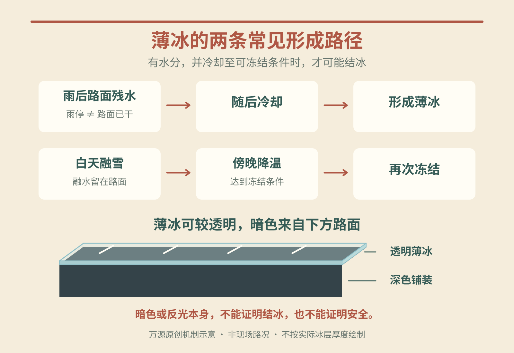

在日本冬季旅行，最容易让人放松警惕的，可能是一段没有白雪、只是颜色略深的路。手机显示气温还在零度以上，为什么走过去仍可能打滑？关键在于：**预报中的空气温度，不是鞋底接触的路面温度；看得见路面，也不等于路面没有冰。**

本文解释城市步行中容易遇到的薄冰形成机制，不判断某条街今天是否结冰，也不适用于登山、进入湖面或冰上活动。理解原因，是为了知道何时需要重新确认路线，而不是学会凭照片判定安全。

## 气温和路面温度，是两个不同的量

日本气象厅的用语说明中，气温通常指地上1.25至2.0米处的空气温度。它描述空气，不是贴着地面测得的温度，更不是每块铺路砖的状态。[气象厅气温定义](https://www.jma.go.jp/jma/kishou/know/yougo_hp/kion.html)

地面会向外发出热辐射。入夜后少了日照供热，表面可能不断冷却，随后再冷却贴近地面的空气，这就是天气预报常说的“辐射冷却”。晴朗、风弱的夜晚尤其容易出现：云对地面的回辐射较少，近地面的冷空气也不容易与周围空气充分混合。[气象厅辐射冷却解释](https://www.jma.go.jp/jma/kids/kids/faq/a5_31.html)

所以，“空气高于0℃”与“地表已经结冰”可以同时发生。国土交通省磐城国道事务所也明确提醒，外气温显示为正值时，路面仍可能冻结。不能给手机温度统一减去一个固定数值，便把结果当作脚下实测值；路面材料、日照和环境不同，温差也会变化。[国交省正气温与路面冻结说明](https://www.thr.mlit.go.jp/iwaki/commun/tairaiji/pdf/tairaiji139.pdf)

手机里的“体感温度”也不能当路面温度使用。风、湿度会影响人觉得多冷，但人的冷暖感受与铺装表面是否达到冻结条件，是不同的问题。穿得暖、身体不觉得冷，不能成为忽略地面状态的理由。

## 暗冰看起来黑，黑色来自哪里

日文“ブラックアイスバーン”常译为黑冰或暗冰。这里并不是水结成了黑色固体，而是较透明的冰层覆盖路面，下面深色铺装仍透得出来，于是远看很像一段湿沥青。

由北海道开发局推荐的冬季步行资讯网站解释，雨后降温可形成这样的薄冰膜，透明冰层使铺装呈现黑色。危险之处正是视觉上的相似：没有白雪、没有明显冰块，不足以排除结冰。[冬季生活推进协议会：薄冰形成](https://tsurutsuru.jp/kotsu8.html)

反过来，深色路面也不一定是冰。光线、湿润程度与材料都会影响外观，不能把“反光”“发黑”当作可靠检测法。官方雪道资料同样提醒，暗冰与普通湿路难以凭外观判断，冷夜、清晨和阴影处尤其要留意。[国交省雪道路面说明](https://www.thr.mlit.go.jp/aomori/syutu/towada/yukimichi/05drive1.html)

## 没在下雪，水也可能留在路上

形成薄冰需要水分。旅行时可以留意三条来源，而不只盯着天气图标有没有雪花。

**雨水。** 雨停后，路面未必已经干燥；随后冷却，就可能留下冰膜。因而“雨已经停了”回答的是降水，不是地面状态。

**融雪水。** 白天升温或阳光照射，使原有雪冰部分融化；傍晚降温后又冻结。初冬在冰点附近反复冷暖变化时，这条路径尤其值得注意。午后刚走过一遍的路，不能直接成为夜间回程的安全凭据。[融化与再冻结过程](https://tsurutsuru.jp/kotsu8.html)

**空气中的水分。** 道路部门指出，桥面冷却、发生结露时，即使没下雨雪，也可能湿润或结冰。因此，不必等一场大雪，才开始关注冬季路面。[桥面结露与冻结提醒](https://www.thr.mlit.go.jp/iwaki/commun/tairaiji/pdf/tairaiji139.pdf)

<figure>
  
  <figcaption>万源原创机制示意（AI辅助），非现场路况；仅示意两条常见路径，不表示有水就一定结冰，不按实际冰层厚度绘制。</figcaption>
</figure>

## 为什么同一条街，只有一小段滑

桥面与普通地面接触条件不同，上下都暴露在空气中，热量更容易散失，附近道路尚未冻结时，桥上可能已出现冰。阴影处获得的日照较少，积雪和冰也可能保存更久；融雪水流入的局部区域，则又增加了可冻结的水分。[政府防灾资料：桥梁、阴影与融水](https://www.bousai.go.jp/kohou/kouhoubousai/h27/81/special_01.html)

步行时还会遇到车站口、横断步道白线、停车场出入口等小范围变化。官方行人提示指出，白线看起来干燥，也可能覆有薄冰；车辆出入处的冰面还可能被车轮磨得更光滑。邻近几步路好走，不能替下一段作保证。

这些是风险线索，不是“桥上必冻、阳面必安全”的地图。已经清雪，也只说明雪被清理过，不能单独证明残留水分没有再冻。

## 出门前多问三句，比只看最低温有用

第一句：**路面水从哪里来？** 看此前是否下过雨雪、白天是否明显融雪，不只看准备出门那一刻的天气。

第二句：**回程会不会处在另一种条件？** 把傍晚降温、阴影路段和桥面计入考虑，不以午后的步行感受推断夜间。晴天有利于观景，也可能伴随晴夜辐射冷却，两者并不矛盾。

第三句：**有没有更接近这段路的信息？** 出门前询问住宿人员附近出口和步行路线的实际情况，结合当地提醒及现场管理，选择已确认可用的通道。无法稳妥通过时，调整路线或行程，不用脚试滑来验证猜测。

鞋底选择、步幅和行李安排可继续看[日本冬季城市雪地步行指南](/blog/b-20261031-120003)；想分清降雪量、积雪深与活动是否开放，可读[日本赏雪旅行怎样用预报](/blog/c-20261104-090009)。温度、路面和通行条件分别确认，才不会把“天气看着不错”误当成“脚下已经安全”。

资料核验：2026年11月11日（日本时间）。本文为形成机制科普，不是实时路面预报或零风险通行保证。
