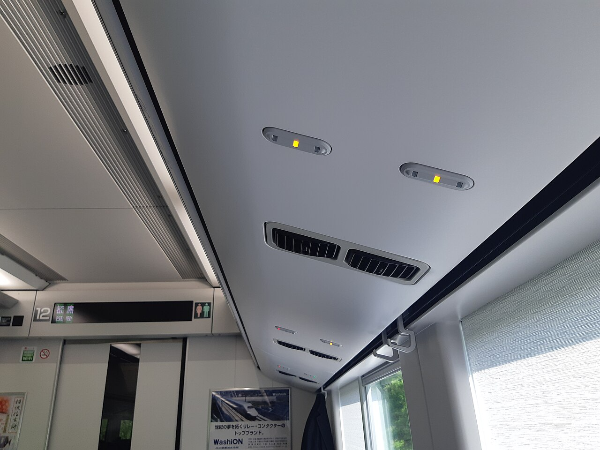

坐JR东日本部分特急时，明明买了特急券，却发现票上没有固定座位；车厢又写着全车指定席，究竟能不能坐？这里容易混淆的是“座席未指定券”。它与自由席特急券不是同一种东西，也不保证有位置可以一直坐到终点。

## 本文只针对官方列明的在来线特急

JR东日本使用指南列出的对象包括踊り子、湘南、あずさ、かいじ、富士回遊、あかぎ、ひたち、ときわ、成田エクスプレス，以及しおさい、わかしお、さざなみ等。官方说明，乘车时间尚未确定或计划车次满席时，可购买座席未指定券；这些列车不能拿自由席特急券直接乘坐。[适用列车与购票指南](https://www.jreast.co.jp/ltd_exp/guide/)

不要把这个机制套到新干线、其他公司特急或每一列临时列车。买票时把完整车名、日期和区间交给工作人员核对，别只说“去甲府的快车”或“东京出发的特急”。如果订单已经标明具体座位，就按自己的指定席使用，不需要另找所谓红灯空位。

## 座席未指定，意味着你没有锁定某一张椅子

可以把两种需求分开：一是当天在合适范围内乘车，二是保证一家人有相邻座位。未指定券解决不了第二项。带幼儿、长辈或大件物品时，反复挪位的负担可能比等待另一班有座列车更大，别只比较是否能上车。

出发时间确定以后，可以在上车前办理座席指定；官方指南列有从未指定券改为指定席特急券的操作，一些票券不能自行在指定席售票机变更，应找窗口确认。[上车前的座席指定流程](https://www.jreast.co.jp/ltd_exp/guide/)

安排时不妨先问同行者：能够接受站立或途中换位吗，是否一定需要坐在一起？如果答案是否定的，就优先寻找可以确认座位的车次。不要到了列车门口才把“有特急券”解释成“家人必须有连座”。

## 红、黄、绿灯要结合乘车区间理解

在设置座位上方指示灯的相应车辆中，绿灯表示已预约，红灯表示当前空位，黄灯表示后续停站起已有预约。未指定券旅客使用空位时，如果该座位的指定席旅客到来，应让出座位；售票状况会变动，红灯也可能突然转成黄灯或绿灯。[官方座位灯号说明](https://www.jreast.co.jp/ltd_exp/guide/)

这和公共交通里“先坐下就可以坐到下车”的习惯不同。把随身包摆得便于收起，别在暂用位置铺开大量食品、外套或电子设备。看到黄灯后就准备整理物品、按指引移动，而不是等预约者站到面前才开始收拾。

若灯色与自己持有的指定座位信息不一致，不要直接和别人争执。先核对日期、车次、车厢、座号以及自己的乘坐区间，再请列车工作人员确认。手机里的购票记录和纸票都应容易取出，付款通知本身不适合用来判断谁有这个座位的使用权。

照片为2019年6月1日E353座位灯位置参考，不代表当前车次或空位状态。摄影可能产生色偏，不按照片判色，红黄绿含义以官方文字说明为准。作者：[Kazehayashi](https://commons.wikimedia.org/wiki/User:Kazehayashi)；[来源](https://commons.wikimedia.org/wiki/File:E353_Seat_Occupied_State_Lamp.jpg)；[CC BY-SA 4.0](https://creativecommons.org/licenses/by-sa/4.0/)。使用Wikimedia的1280像素缩略图，未另作修改。

## 有些适用列车根本没有灯

官方特别说明，あかぎ、成田エクスプレス、しおさい、わかしお和さざなみ等车辆没有这套座位上方灯号；部分其他班次也可能使用不带灯的车辆。因此，不能把“找红灯”写成所有适用列车的统一操作。[没有座位灯的车辆说明](https://www.jreast.co.jp/ltd_exp/guide/)

没有灯并不代表空座都无人预约。准备使用空位时仍应遵守未指定券规则，遇到持指定席券的人让座；不确定哪里可以等待，就询问车内工作人员。切勿自行进入其他等级车厢，或把车门、洗手间通道当成长时间摆放行李的空间。

乘成田特快时，还需先确认车厢开往哪里。座位暂时空着，与该车厢是否到自己的目的地是两件事，可结合[N’EX分车厢目的地说明](/blog/narita-express-split-carriage-destination-2026)检查。

## 满席时怎样做决定，比抢空位更重要

先看后续有座车次是否仍满足住宿或活动时间；如果改乘普通列车，应重新核对总耗时与换乘次数，而不是只看出发早晚。旅行时间不紧的人，可以留出一顿饭或站外休息，把交通从赶路变成可控制的安排。

基础车费与特急券也要分别准备，不能因为持有一种附加票就省略进站所需车票。首次使用铁路可先看[交通卡与单程票区别](/blog/b-20261010-090000)。本篇解释的是特定在来线服务的座位使用方式，不处理优惠票误车或新干线全席指定期间的例外规则，更不保证临场有空位。
