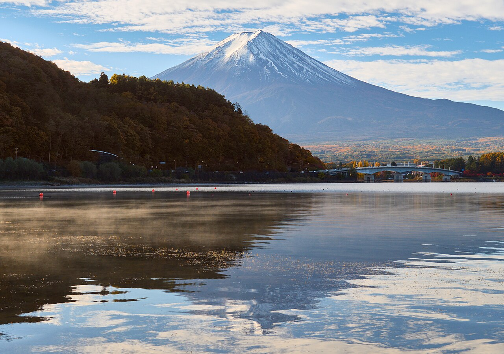

2026年12月13日在河口湖退房，即使不跑富士山马拉松，也不能按普通周日约酒店门口接车。湖边交通限制分区、分时，真正决定能否上车的是**住宿门口那段路和停车口**，不是较远的河口湖大桥是否已经解除限制。家里有长辈、大箱或需要转车的人，先确认能否带着行李从退房地点走到可达上车点，再买不能轻易变更的后续票。[赛事交通公告与管制图](https://mtfujimarathon.com/traffic-regulation/)

## 周六不是正式跑赛日，也不等于桥区全天通行无变

官方[两日管制图](https://mtfujimarathon.com/2026/img/pdf/traffic_restrictions2026ENG.pdf)标明，**12月12日周六**河口湖大桥附近8:00至10:00有部分单车道限制；**12月13日周日**大桥路段标为8:45至11:10受限。其他区段各有自己的设置，河口湖与西湖周边不是同时封、同时开。车在桥外还是桥内、去车站要不要经过封路点，都比在地图上看到几公里更重要。仅作普通游览的人，路线可参考[河口湖和山中湖一日怎么分](/blog/d-20261009-063203)，赛日不能照搬所有停靠点。

*河口湖与富士山，摄于2025年11月12日。不是2026年赛事当天，不用于判断可上车点或道路状态。摄影：[lumoplank](https://www.flickr.com/photos/199350666@N08/55079518453)｜[Wikimedia Commons 原图](https://commons.wikimedia.org/wiki/File:Kawaguchiko,_Part_III_-_Kawaguchiko6782.jpg)｜[CC0 1.0](https://creativecommons.org/publicdomain/zero/1.0/)。采用维基共享资源的缩略版，未另作修改。*

## 富士Lake Hotel：桥过得去，车也未必开得到酒店

[富士Lake Hotel于11月21日的公告](https://www.fujilake.co.jp/news/224/)预计周日8:15至15:15门前道路完全封闭，来客自驾车和酒店接送车辆均不能进出停车场。住这里的人，不应在11:10桥区管制时段结束后就默认可以叫车到入口；车已经停在酒店，也不能在封闭窗口内保证驶出。[富士View Hotel另有公告](https://www.fujiview.jp/news/fujisanmarason.html)列自己的接驳和交通安排，不能把前者的封闭时间用于后者，反之亦然。

提前向住宿确认退房、寄存或提箱办法，再问当日有没有**对车辆实际开放、现场允许停车上下客**且旅客走得到的位置。若有人腿脚不便，应把步行距离、过街、坡度和自己能搬几件箱子说清；对路面不熟时，宁可改乘已确认能到的公共交通或改时间，不在封闭口把一家人和行李放下来临场找路。确认后的接车点把日文地点、道路哪一侧和备用联络方式写进预约，不只写“河口湖附近”。

富士View Hotel公布周日上午去河口湖站仅7:00、7:30、8:00、10:30、11:30几班，反方向上午仅10:45、11:45。例如错过8:00后，不能照平时预约认定8:30接驳仍有。即便有适合自己的去站班，也先询问能否带全家行李、是否需要预约；它不是其他住宿客人可依赖的替代车。

若决定在酒店等，公告另明示本馆住客12月13日退房后可用大浴场，须等10:00开始的清洁结束，不保证确切重开时刻，非住客不接待日归。这是等候的一个可能选项，不表示酒店替你保管行李或按时接送。

若已经订有司机，把酒店给出的现场联络点转给对方，请对方用实际行驶方向核对。如果只能确认到一个路口，不能确认在哪侧停车或路口是否可过，就还没形成可执行的接送方案。当天人群把通道变窄时，不让司机在赛道或警戒线边等。

## 15:39有车，不表示15:15解封后再叫车来得及

JR东日本[当月富士回游88号](https://timetables.jreast.co.jp/2612/train/180/184781.html)列河口湖15:39发、新宿17:47到。若原计划等富士Lake Hotel于15:15解封再叫车，院外通行到列车出发只有24分钟；仍需考虑车辆何时能到、装行李、进站。酒店普通日[交通页](https://www.fujilake.co.jp/access/)给到车站步行约10分钟，不等于赛日拖箱、过街和排队也只用10分钟。走得动又能确认可步行路径的人，可选择更早出发；不能走的，优先换一个后续时间，而不是押解封准点。

返东京若改走巴士，逐条核实乘车点及当天运营通知，不照去年改道图，也不把一段车路封闭推成所有巴士停驶。需要处理临时变化可看[电车停运与接续应对](/blog/b-20261013-090001)。资料核查于2026年11月25日；不提供车票余量、管制实时状态或酒店接客保证。
