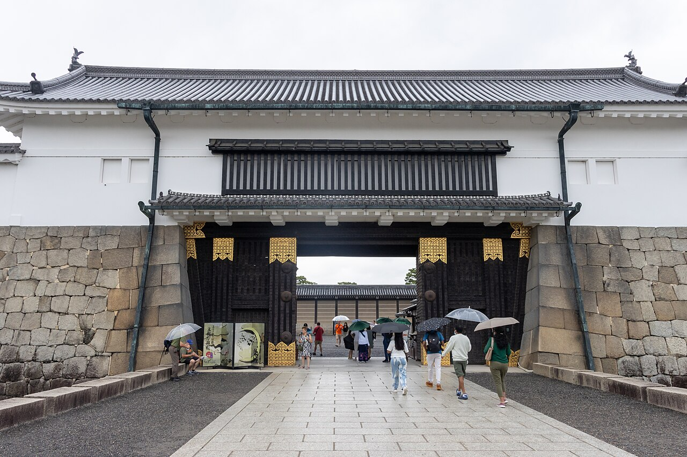

如果2026年12月6日才到京都，想下午进二条城，不能照平时16:00的最后入城时间规划。**当天二条城12:00停止受理入城，二之丸御殿12:10停止观览受理。**同一天的宽永行幸重现队伍预定14:20至14:30才抵达东大手门。等到队伍到了再买普通入城票，已错过官方公布的白天入口时限。[二条城12月6日特别通知](https://nijo-jocastle.city.kyoto.lg.jp/news/12-6uketsuke/)

## 想进城，上午把两个受理时间都留出来

当天17:00闭城没有变，改变的是新访客入城受理。若主要看二之丸御殿，必须先完成城门入场，再赶到宫殿受理处；12:10不是给城外访客多出的十分钟。上午已经有大件行李寄存、买票或同行集合的人，宁可把午餐放到出城之后，也别打算在接近正午时才从车站过来。

来城停车场的普通日间入库也在12:00截止，18:00前出库；不要把可出库到傍晚理解成下午还可驶入。已在城内的人仍要按现场指引移动。除二之丸以外，本丸御殿、展示收藏馆和城内看行列的具体办法，请找日别更新；不能从一般的冬季原画展资料推断那天的受理或可视区。原画本身和其他日期的规则可参照[二条城冬季障壁画原作指南](/blog/nijo-castle-winter-original-paintings-2026)。

*京都二条城东大手门日间外观，摄于2024年6月23日；不是2026年12月6日活动现场。摄影：[Mike Peel](https://commons.wikimedia.org/wiki/User:Mike_Peel)｜[Wikimedia Commons 原图](https://commons.wikimedia.org/wiki/File:At_Kyoto_2024_390.jpg)｜[CC BY-SA 4.0](https://creativecommons.org/licenses/by-sa/4.0/)。使用维基共享资源提供的缩略版，未另作修改。*

## 午后只看行列，从京都御苑或沿线选一个位置

重现的是1626年后水尾天皇赴二条城的宽永行幸。主办方按史料组织中宫和子、将军家光与后水尾天皇三组，计划约330人参与，穿着装束，也演示不同队列的礼法。活动表列约12:30从京都御苑建礼门前出发，出中立卖御门，经乌丸通、下长者町通、东堀川通到二条城东大手门。想看装束和队列，不必一定挤到终点；按当日划定区域选择一个易进易出的沿线位置，和家人约好在那里等。[四百年祭路线与举办条件](https://kaneigyoko400.jp/procession/)

若家人在同一个上午就想进城、又想完整看出发，不要把两件事看成能自然连上的套票。城门正午截止，御苑约半小时后发队，两处之间既有移动也有候场。更看重建筑就确认上午城内参观，午后只在离开方向顺路的地点等一组；主要为了装束，可把城内参观移到另一天。行列分三组，看到一组后并不意味着交通已经恢复，过街以现场导向为准。

京都御苑另有[装束观览席项目](https://kaneigyoko400.jp/viewing/)，属于穿指定装束在特定席位观览的单独付费申请，目前报名已截止，不是所有沿路观众的入场手续，也不等同于二条城普通门票。想看城内到着环节，先查主办方公布的资格和动线；持普通票不代表一定能在东大手门内侧等候。只看一段行列，也不要将14:20前的数字套给每个街口。

## 下午出行留一条不依赖巴士准点的路线

主办方11月19日交通公告列乌丸通、东堀川通、堀川通等区段分时限制，最早约12:40，最晚一段预计至15:10。有些市巴士绕行，另有车辆待队伍过街后再走。选住宿、用餐和离开方向时，先看看是否需要跨过行列主路，再比较步行和[京都地铁东西线二条城前站（T14）](https://www2.city.kyoto.lg.jp/kotsu/tikadia/hyperdia/menu0136.htm)。当天走哪个出口、出站后哪侧可步行，以站内提示和现场引导为准。临时叫车也要按现场可通行地点上车，不宜将车门口接到自己预计的观览位置。[交通限制与公交改道公告](https://kaneigyoko400.jp/en/news/2063/)

小雨照办，雨天取消室外行列，官方拟当天清晨判断。取消时不实施这次公告列出的限行和改道；但不能因此推定室内替代仪式向一般访客开放，或城门自动恢复16:00受理。若想多留一晚看灯光，另查[二条城NAKED夜游](/blog/d-20261027-090005)：这项夜展12月5日结束，不是12月6日行列的晚场。资料核查于2026年11月24日。
