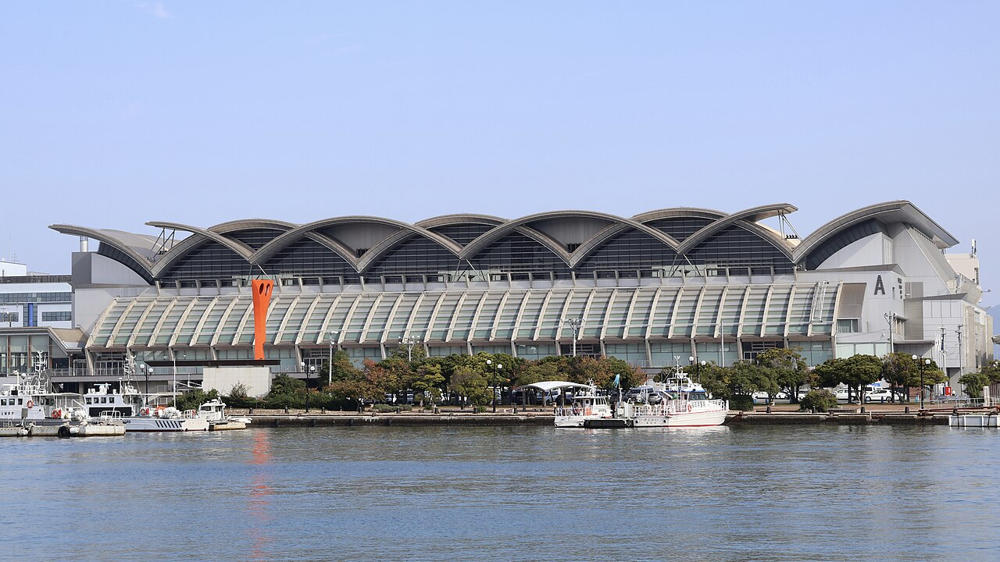

准备12月到九州看设备、加工技术或制造业数字化方案，先别把“福冈展”直接写成一个地点就结束准备。**2026年ものづくりワールド福岡使用Marine Messe福冈A、B两馆；博多站有会期免费接驳，但它不是机场巴士。**本文按11月17日可查的官方资料整理。

## 先确定看的确实是福冈这一届

[举办概要](https://www.manufacturing-world.jp/kyushu/ja-jp/about.html)列明，展期为2026年12月2日至4日，每天10:00—17:00；制造业World福冈与首届九州半导体World同时举办。产品方向包括加工零部件、设计制造软件、工厂设备及计测检查等，不是面向家庭的工业体验乐园。

同一品牌还有其他城市的展会。向同事转发资料时，最好在标题写上“福冈、12月2—4日”，不要只传搜索出来的一张旧海报。找展商也应从本届名单出发，不能根据企业参加过东京展，就认定这次一定在福冈。

*会场外观，非2026年展会现场或接驳站位置示意。摄影：[S5A-0043 / Wikimedia Commons](https://commons.wikimedia.org/wiki/File:%28JPN-Fukuoka%29_Marine_Messe_Fukuoka_Hall_A_2024-11-14_-_1.jpg)，[CC BY 4.0](https://creativecommons.org/licenses/by/4.0/)。采用Wikimedia提供的1280像素缩略版本，未另行裁切。*

## 免费窗口到12月1日，不是一直免费

[官方来场页](https://www.manufacturing-world.jp/kyushu/ja-jp/visit.html)的普通登记入口写明，截至12月1日免费，之后转为5,500日元含税；若持展商邀请，应另外核对该邀请入口的适用条件。一次登记在会期三天有效；多人一起办理也需要每位参加者的信息和各自邮箱，不要只给领队准备一张胸卡。

官网提供提前彩色打印胸卡，以及持相应二维码到会场机器打印两种方式。建议出发前逐人检查是否能打开自己的凭证，而不是到了入口才发现邮件被转发错。交流会有独立的事前申请说明，有展会胸卡不代表已经订好交流会席位。

## 博多接驳的去程和回程不在同一侧理解

[主办方交通页](https://www.manufacturing-world.jp/kyushu/ja-jp/visit/access.html)公布会期临时免费接驳，无需事前申请：去程从博多站筑紫口出发，计划运行8:00—16:00；回程从A馆后方乘车，计划12:00—18:15。具体上车点请打开该页的当届示意图确认，班次会受交通状况影响。

这项服务连接的是博多站与展馆，不能据此安排从机场直接坐接驳。刚下飞机的人，先完成入境或国内线到达手续，再计算前往博多站的时间；离场后赶飞机，则要把排队、道路和机场手续都算进去，别以接驳末班时间作为能赶上飞机的保证。

不想等车时，可以比较公共交通或出租车；会场并非地铁一出站即到，步行需求也要纳入判断。带大箱子的人，先核酒店或车站寄存安排，可参看[日本车站储物柜使用](/blog/b-20261013-090000)。不应假定临时接驳一定能放下所有大件行李。

## 两馆参观，按采购问题分组比按展名打卡有效

建议先把目标展商按馆和会面时间标出来，再选择上午、下午的重点区域。需要技术同事一起判断的演示尽量排在同一时段，避免采购人员看完后只凭照片转述。不要为了“两个馆都逛过”反复横穿会场。

比较加工供应商时，可以统一询问材质、加工范围、样件条件和交期；比较软件时，先问与现有流程的连接方式及试用边界。现场留下的问题应当能带回公司继续验证，而不只是收集名片。

如果同事分头行动，午间或离场前花十分钟合并记录：哪些供应商值得跟进，哪些只是看起来有趣，哪些关键条件仍未回答。也把预约讲座、交流会和返程交通分别核对。展会是一次集中了解供应商的机会，不能把主办方公布的展览规模当成自己的采购成功率。
