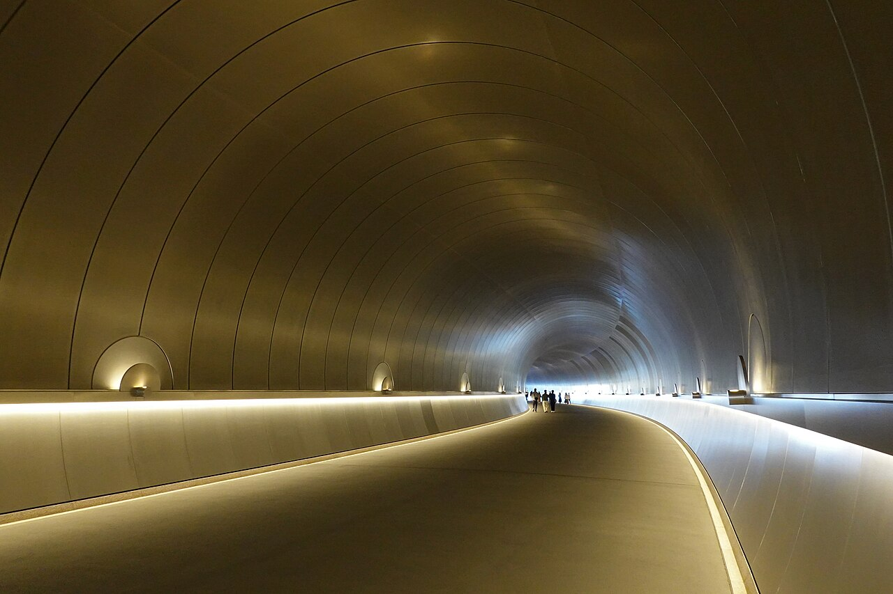

京都周边冬季旅行，MIHO MUSEUM不能被当成任何一天都能临时加入的室内备选。**2026年秋季展览到12月6日结束，11月23日开馆、24日休馆。**想在十二月上旬去，应先锁定开放日期，再安排交通；圣诞假期不要照搬这张秋季展期表。[官方秋展说明](https://www.miho.jp/exhibition/autumn2026-2/)

## 分季开放，不只是每周一休息

馆方FAQ说明，春、夏、秋各开放期间之外休馆，季内通常周一休息，遇周一节假日则翌平日休馆。因而“周二至周日都开”只是容易误导的简写，离开本季日期后不再适用。[官方开馆规则](https://www.miho.jp/faq/)

把美术馆写进路线之前，建议在日历上同时标出旅行日期、展览末日与当周休馆日。尤其十一月下旬连续假期，星期几并不能独立决定能否进入。若日期已经固定且不在开放期，直接改选其他目的地，比抱着“建筑外面看看也可以”的想法专程进山稳妥；馆区能否进入不能自行推定。

## 已进入后期，不是海报上的作品都还在

“花ひらく寛永の美”后期为11月3日至12月6日，主题转向寛永时期的茶文化。展览页明确区分前期、后期与通期作品，主图出现的祭礼图屏风标注为前期，不能据此承诺十一月下旬还看得到。[展览与展期区分](https://www.miho.jp/exhibition/autumn2026-2/)

如果为某件作品而来，先查看作品旁的期间标签，再核对展示替换表。若主要兴趣是建筑与整体藏品，则可把特定作品当成加分项，不必把一次参观变成核对海报的任务。同行者艺术兴趣不同，约定一两个重点之后各自慢看，通常比从头到尾追逐同一条讲解路线更舒适。

参观前可读[日本美术馆准备指南](/blog/b-20261011-090008)，了解门票、行李与拍摄规则如何确认。本文不把官网图片的公开展示理解成旅客可以任意拍摄或转载作品。

## 16点入馆截止，17点闭馆

官方列开放10:00至17:00，最后入馆16:00。成人1300日元，高中与大学生1000日元，中学生以下免费；普通个人参观不需要预约，但可预购网上票。[来馆信息](https://www.miho.jp/information/)、[个人预约问答](https://www.miho.jp/faq/)

不要把16点当成推荐到达时间。刚好赶在截止前进入，仍可能没有余量细看展览、休息或处理同行需求。两名成人与一名中学生的入馆预算可按2600日元估算，但孩子若已进入高中，适用票种就不同，不能只按看上去年龄猜测。

这里的入馆票涵盖馆方列明的展览范围，并不是餐饮预约。想把午饭或咖啡作为行程重点的人，应单独留出等候时间，不要把所有空间都按闭馆时间推定仍在服务。

*照片：2024年11月拍摄的普通隧道步道，非2026年展览或当前红叶实况。摄影[663highland](https://commons.wikimedia.org/wiki/User:663highland)，[Wikimedia原文件](https://commons.wikimedia.org/wiki/File:241119_MIHO_MUSEUM_Koga_Shiga_pref_Japan06s3.jpg)，许可[CC BY-SA 4.0](https://creativecommons.org/licenses/by-sa/4.0/)。使用Wikimedia提供的1280像素缩略图，未另行裁切或修改。*

## 接待栋与美术馆栋之间还有一段路

官方交通说明从JR石山站乘帝产巴士，参考约五十分钟。抵达后也不是立刻站在展柜前：接待栋至美术馆栋约五百米，步行参考七至八分钟，免费电动车在拥挤时可能为安全而暂停。[交通与馆内移动](https://www.miho.jp/information/)

带长者或使用助行设备时，提前说明移动需求，不要把电动车当成永远随到随坐的保障。即使买了票，步行速度、下雨撑伞和拍照停留仍会改变时间。特别是返程，应从离开展室开始计算，而不是等到公交快发车才动身。

## 适合把一日游做减法

建议将MIHO设为当天主要目的地，再决定是否加一个轻量停留，而不是同时叠加京都市内寺院、信乐购物与晚间灯光。若返程车次约束较强，就优先保留完整参观，删除可有可无的第二站。

年末还有其他预约时，可用[日本跨年休馆检查清单](/blog/b-20261021-090006)逐个核对设施，而不是给整个城市统一标“正常营业”。本文关注本季日期与参观边界，不保证实时道路、馆内餐位或某件藏品临时变更后的展示状态。

*核验日期：2026年11月20日。*
