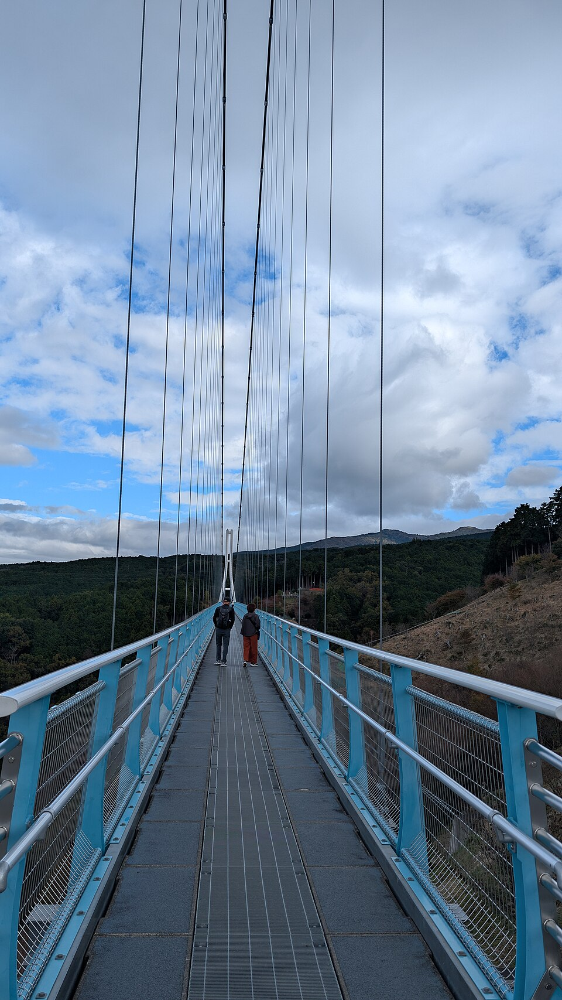

三岛Skywalk的“秋之得旅计划”使用期到2026年12月6日，销售却到**12月5日结束，而且限事前购买**。它将吊桥入场券与园内金券组合，适合本来就准备玩体验、吃饭或购物的人；只想过桥看风景，不必看到“优惠”就先买套票。[园方秋季得旅公告](https://mishima-skywalk.jp/pickup/50309/)

另一个值得提前查的区别是：吊桥营业，不代表所有亲子项目每天营业。计划从三岛或箱根过去，最好依次决定出行日期、想玩的项目和返程，再选票。

万源场所参考｜三岛 Skywalk，2025年11月6日实拍，非2026年活动现场。摄影：[Joli Rumi](https://commons.wikimedia.org/wiki/User:Joli_Rumi) / [Wikimedia Commons](https://commons.wikimedia.org/wiki/File:Mishima_skywalk,_Japan%27s_longest_suspension_bridge,_Shizuoka_Prefecture,_Japan.jpg)，[CC BY-SA 4.0](https://creativecommons.org/licenses/by-sa/4.0/)。采用Wikimedia Commons提供的960px等比缩小版，内容未修改，完整构图。

## 先分清普通吊桥票和附金券套票

园方普通吊桥票采用浮动价格，成人1100日元起、中高中生500日元起、小学生200日元起；其他体验另外收费。这里的“起”不能省略，也不能把票价当成十一月所有日期的统一报价。[官方营业时间与票价](https://mishima-skywalk.jp/guide/)

秋季套票分为附1000日元金券和附2000日元金券两种。公告建议前者用于餐食购物、后者用于体验项目；适用于成人、中高中生、小学生，幼儿因吊桥入场免费而不属于此套票对象。金券到访时在票务窗口领取。[套票构成与领取方式](https://mishima-skywalk.jp/pickup/50309/)

比较时列三笔即可：当日普通吊桥票价格、原本就打算消费的项目金额、对应套票结算价。不要直接把金券面额当成省下的钱，也不要为了用完金券新增自己不想玩的项目。本文不将未显示在公告文字中的结算价、找零和退款办法写成保证，购买前须在实际商品条件里确认。

## 12月6日去，不能当天才开始找这张优惠票

官方销售期为10月19日至12月5日，使用期为10月24日至12月6日。对会期最后一天出行的人，至少先把“前一天完成购买”列为准备事项，并核对商品页面是否另有具体下单时限或售卖状态。[预购与使用期限](https://mishima-skywalk.jp/pickup/50309/)

如果先订了不可取消的远途交通，再发现目标日期的商品或体验不适用，省下的票费未必值得改行程。更稳妥的顺序是确认体验、核对当日总价和取消条件，再决定是否购买套票。保存日期、人数、票种及领取方式，别只保留一张付款截图。

官网活动页仍可能出现已经结束的11月7、8日夜间烟花说明。11月9日以后出行，不要据此以为每周末都能看烟花；普通白天吊桥票与限定夜间活动应分别查。看见仍在线的页面，首先检查适用日期。

## 带孩子玩，先看项目日历而不是“全年无休”

园方[11月、12月体验营业日公告](https://mishima-skywalk.jp/information/49260/)明确，森林冒险的Canopy、Kids课程，以及E-BIKE越野导览存在休业日。吊桥总营业信息与项目日历负责不同问题，不能从“园区开门”推断孩子最想玩的课程也开放。

预订前逐项核对：孩子对应哪个课程、身高年龄是否符合、是否需要成人陪同、能否在目标日期参加。课程名称相似也不能互换。若最重要的亲子项目当天休业，应先换日期或降低对行程的期待，再决定是否仍需要附2000日元金券的产品。

公告的具体休业日以图示日历提供，请按出行日期逐日核对对应月份日历；不同课程休业日可能不同。这样能避免把上一月的星期排列套进下一个月，也避免只看网页发布日期便误判日历年份。

## 只过桥、玩体验、从箱根顺路来，分三种排法

只看吊桥的人，可以将其作为半日主项目：先查天气与可用巴士，抵达后过桥、散步，再按返程计划离开。富士山能否看见受天气影响，买哪种票都不构成可见保证。若能见度是唯一目标，应在交通取消条件允许的范围内保留调整空间。

体验为主的人，先锁定课程及集合要求，把过桥、吃饭和购物排在前后。票价较合算的前提，是当天确实能使用想要的内容。不要把活动开始前十分钟才抵达园门当作充分提前，换票、找集合点和装备准备都可能占时间。

从箱根过去的人，则要先看当天往三岛还是回箱根住宿。园方交通页分别链接三岛站方向、元箱根港方向的巴士资料；地图上连接两地，不代表任何时间都能无等待地接上。[官方交通与时刻表入口](https://mishima-skywalk.jp/access/)

若晚上住一泊二食旅馆，按晚餐与最晚入住倒推离园时刻，不要因为园区营业到傍晚就玩到最后。箱根整体路线可参考[箱根一日游或住一晚怎么选](/blog/d-20261010-090002)，尽量避免同一天又走完整环游线又加长时间冒险体验。

## 回程不是看完夕阳后才处理

核验时园方营业页显示9:00至17:00，并提醒天气或活动可能改变时间。日常营业终点不是最后一班巴士的承诺，买票前应从官方交通入口查看旅行日的去程和回程，分别保存站名、方向与候车位置。[园方时间说明](https://mishima-skywalk.jp/guide/)

自驾也要给道路留余量。园方提醒连休周边可能拥堵、停车位有限；接送车辆不会让体验准点或返程堵车问题消失。同行者玩不同项目时，先约一个明确集合点和停止追加活动的时间，不要靠临时打电话寻找彼此。

## 一家人不用把同一种票买到所有人名下

规划家庭开支时，可以先分别列出成人、学龄孩子与幼儿的实际需求。有人只过桥，有人想参加体验，所需金券和票种未必相同；尤其幼儿不在本次套票对象里，不能仅按家庭总人数购买。优惠是否允许不同成员共用、是否限定项目，应以商品说明为准，未确认前按各自使用来算。

有体验预约的人，还要把体验确认与吊桥电子票分开保存。前者证明课程时段，后者处理入场或套票换领，任何一份都不宜擅自当作另一份的替代凭证。订完后把同行者姓名、人数、日期再核对一次，发现不符时先处理订单，不到现场才开始修改。

最后检查金券未使用部分的处理、票券凭证和返程，不把购物排在必须上车前的最后几分钟。电子门票准备方法见[日本景点电子票检查](/blog/b-20261013-090003)。本文核验于2026年11月9日（日本时间），未宣称实时余票、体验名额或当日富士山可见度。
