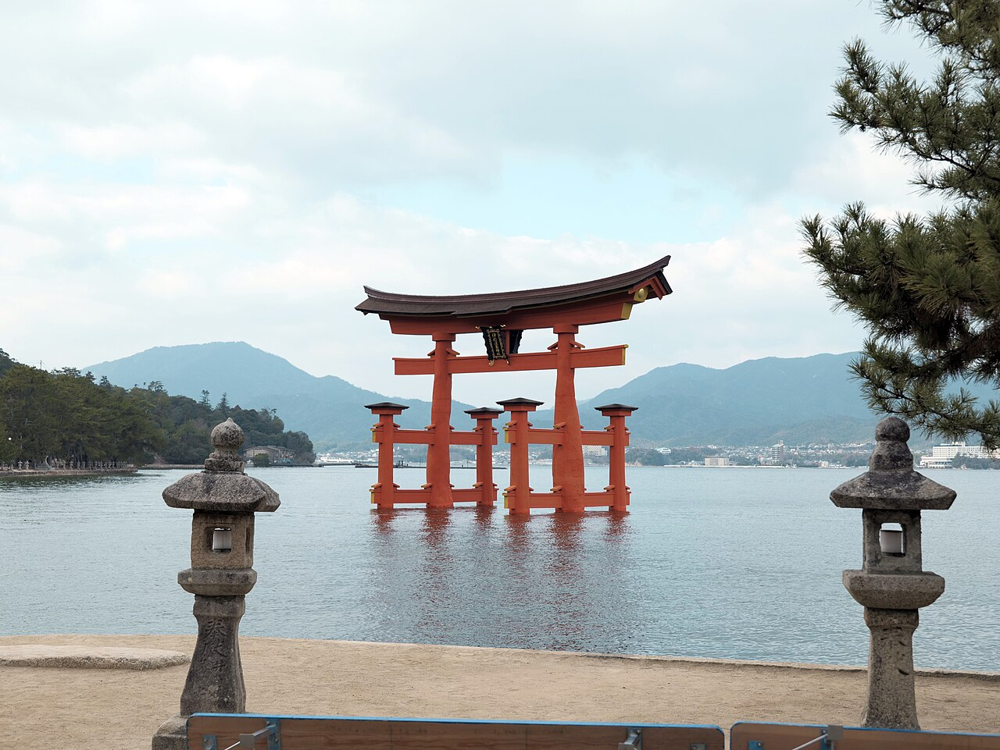

2026年除夕想在广岛看一场当地仪式，不一定要站到午夜。宫岛观光协会当年日历列，**12月31日18:00至18:30左右，严岛神社附近御笠滨举行镇火祭**。它不是跨年倒数，也不需要把当天所有行程推迟到晚上。先决定是专门看这一场半小时左右的仪式，还是还想在岛上等元旦参拜，晚上所需的船和住宿完全不同。[宫岛观光协会2026年12月日历](https://www.miyajima.or.jp/event/calendar12.php)

*御笠滨一侧望向严岛神社大鸟居，摄于2024年1月12日。不是镇火祭现场，不能用来判断当晚潮位或站位。摄影：[Hyppolyte de Saint-Rambert](https://commons.wikimedia.org/wiki/User:Hyppolyte_de_Saint-Rambert)｜[Wikimedia Commons 文件](https://commons.wikimedia.org/wiki/File:Itsukushima_%28Miyajima_Hiroshima%29_hdsr_Torii_S5_01.jpg)｜[CC BY 4.0](https://creativecommons.org/licenses/by/4.0/)。采用 Commons 缩略版，未另作修改。*

## 先找御笠滨，不按海上大鸟居定位

协会把会场写作御笠滨，从岸上的石鸟居到严岛神社入口一段。地图上的海上大鸟居是地标，不是所有人都要走到鸟居底下才算看见祭事。涨落潮会改变岸边的景象，但不使沙滩成为观礼看台。到达后沿允许开放的通道，在不挡居民和工作人员的位置停留，不越封锁线，也不给孩子安排在大人看不见的前排。[镇火祭传统与会场](https://www.miyajima.or.jp/event/event_chinka.html)

本地将镇火祭作为祈愿来年免受火灾的神事。不同大小的火炬由居民带来，照亮的不是拍烟花的天空，而是队伍经过的滨边；小火炬熄灭后带回家供奉，也有祈愿防火的意义。初看者不必追着最大的队伍挤，留耳朵听声音、给队伍让出路，比为了完整录像沿岸奔跑更适合这种场合。观众不要自行携火、加入搬抬或进入队伍即将经过的空间。

## 只看祭礼，白天的重点留在海边这侧

想兼顾宫岛白天散步，可把严岛神社参观和用餐放到天黑前，再在离会场容易到达的一段等候。既想从高处看岛，又要赶上傍晚仪式的人，应先核自己平日的下山速度和当日设施时刻；把岛上下午排得太满，最后会在回到岸边时失去选择位置的余量。已有[宫岛潮汐与常态行程](/blog/d-20261012-090006)可供取舍，别直接把平日路线用于节庆人潮。

如果不仅想看热闹，还想看懂仪式，可以把“祈愿祛除火难”与“居民给家里带回护符”这两点先告诉同行者。这样即使站得较远、只看到几支火炬，也知道在看什么。带相机的旅客可选择不耽误行走的地方拍一两张，开始有人变换位置就把相机收起来；海边风向、烟和人群变化都比白天看路更加影响舒适度，宁可早一点走，不以离火炬近作为看得好的标准。

神社白天拝观、御笠滨傍晚观礼和跨年参拜是三个时段。即使晚上能在外围看镇火祭，也不能从祭礼开始时刻推断白天参观的入口仍受理，更不能把它理解成祭后立即就是元旦参拜时段。参拜另看[严岛神社拝观时间](https://www.itsukushimajinja.jp/jp/admission.html)与特例公布，街上等候与岛上住宿也不是同一安排。

## 看完就走与留岛跨年，提前选一种

当晚回广岛，先查实际乘坐的渡轮运营方与12月31日宫岛出发方向；下船后还要看宫岛口接JR或电车能否接上，再确定住处如何到。JR渡轮有[年末年初时刻入口](https://jr-miyajimaferry.co.jp/timetable/newyear/)，不要只保存普通冬季表，亦不挪用另一家船公司的班次。建议将一班靠后的车也记录下来，不能把18:30左右结束视为18:30已经到码头。若担心两段衔接，先以本州一侧最后可用的陆路班次倒推离开会场时间。

如果同行人怕冷，可在白天先认好回码头的方向，到时根据拥挤程度提前离开，不为拍齐全程让孩子或长辈硬等。决定留岛的，另问住宿能否寄存、晚饭供应和回房门禁；跨年前后另做[年末休馆与用餐检查](/blog/b-20261021-090006)。资料核查于2026年11月27日；以现场安全引导和所乘交通官方通知为准。
