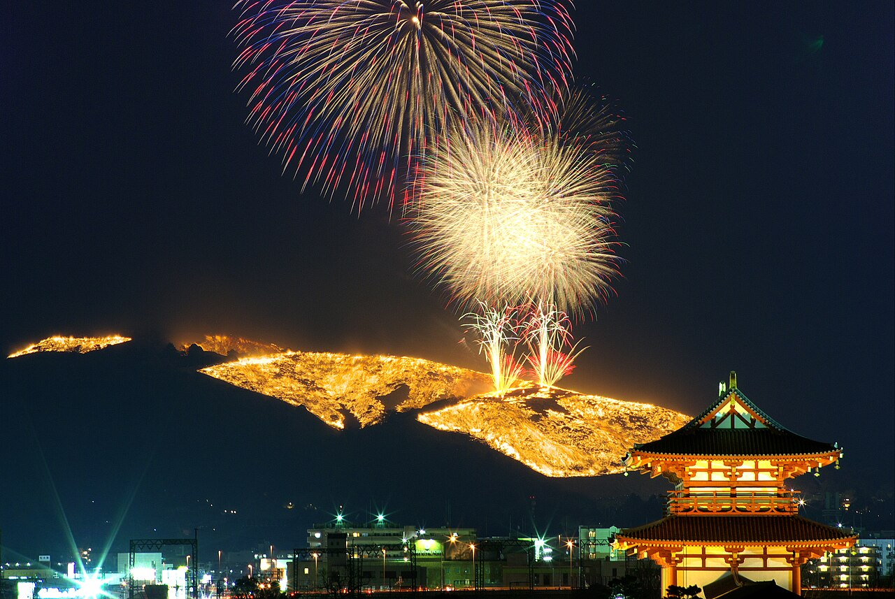

若草山烧山定于2027年1月23日，付费票已从2026年11月20日开售。计划晚上去奈良时，先选自己想记住的画面：是山体连同烟花的远景，还是站在山麓看山火从坡面铺开？前者能从奈良公园的免费园地观看，后者要持山麓付费票并站着看。想坐着观览或有轮椅同行，则要看奈良公园巴士总站屋顶的不同票种。**活动预计18:15先放烟花，18:30开始点火，不是同一场景在同一时间发生。**[执行委员会官方问答](https://yamayaki.pref.nara.lg.jp/faq/)

*2011年1月22日于平城宫迹远望的长曝光历史照片，不代表2027年节目同一时间发生，也不保证当年任何观览位置的视角。作者[名古屋太郎](https://commons.wikimedia.org/wiki/User:%E5%90%8D%E5%8F%A4%E5%B1%8B%E5%A4%AA%E9%83%8E)，[图片来源](https://commons.wikimedia.org/wiki/File:110122_Wakakusayama_yamayaki.jpg)，[CC BY-SA 4.0](https://creativecommons.org/licenses/by-sa/4.0/)。使用Commons提供的1280像素缩略图，未另作裁切或修改。*

## 不买票也能看：愿意边走边调整就选公园

春日野园地和浮云园地等是无需观览票的公共区域，适合想看山体全景、减少支出的人；春日野园地还有太鼓奉纳演奏。免费不是预留位置，意味着热门角度可能会被先到者占满。带孩子不必挤到第一排，先在还没有完全入夜时找一条有余地的路线，并约好走散后的集合点。只想看全景的人，不用为了离火更近再从园地穿过人群去山麓。

山麓票买的是近距离观看，不是椅子。芝地有坡，长时间站立或需要平整地面的人应认真考虑。早鸟价2000日元，至2027年1月15日23:59；1月16日至22日前售2500日元；如前售未售罄，当天才可能现场售3000日元票，手续费另算。每名监护人可带一名小学生及以下儿童免费，其余儿童按规定购票。[奈良县售票公告](https://www.pref.nara.lg.jp/n111/p060032.html)

如果是第一次带孩子看大型夜间活动，换一个问法：孩子能否在没有座位、山风较冷的环境下等到烟花结束，还愿不愿意继续看火？只想看十几分钟烟花的话，免费园地可能更容易随时走；确实想感受坡面点火的过程，再为山麓安排早到。轮椅同行时则先核对屋顶票种和陪同名额，不靠临时寻找可坐的位置。家庭作此取舍时，不必以成人最想拍照的点决定全队站在哪里。

## 想坐，先分清屋顶普通席与轮椅替代席

屋顶普通体验票10000日元，为指定坐席并含演出等体验，小学生以上一人一票，未就学儿童不可入场。屋顶另有10000日元的高级轮椅区；2000日元的轮椅观览席则是山麓不利于轮椅通行的替代选项，不含演出等高级体验，每名轮椅使用者最多可带三名同价同行者。不能走山路的人，不要先买站席再把入场调整交给现场工作人员。

官方普通购买渠道须提前在便利店领取纸票，不能仅凭手机截图入场。**山麓还需先到奈良春日野国际论坛「甍」换腕带，再走到山麓；**官方估算这第二段步行约15至30分钟。近铁奈良站2号出口到「甍」步行另约20分钟，JR奈良站约40分钟。捏着票直接往山门冲，并不能省去换领步骤。

## 散场按步行走，不把山脚当作上车点

活动没有专用停车场，官方建议公共交通。花火结束就走不一定比多看一会更快：执行委员会提醒，18:30前后山麓及大佛殿前一带特别拥挤，去近铁奈良站可能用到约一小时；能耐寒且有回程余量的人可看至约19:30错峰。想早点回去、或家人夜间走路慢，则从一开始就选离回程动线更顺的园地，不等人群聚拢后才跨区。

官方预计活动当天13:00前发布举办与否，取消不顺延，也不逐个联络购票者。出发前看官网，再确认车次与现场公交绕行。白天还有体力可参考[奈良公园与东大寺步行路线](/blog/d-20261010-090007)只加一个停留；[12月春日若宫御祭](/blog/kasuga-wakamiya-onmatsuri-2026)是另一场祭礼，其观览席与票务不能套用。资料核查于2026年11月22日，日本时间。
