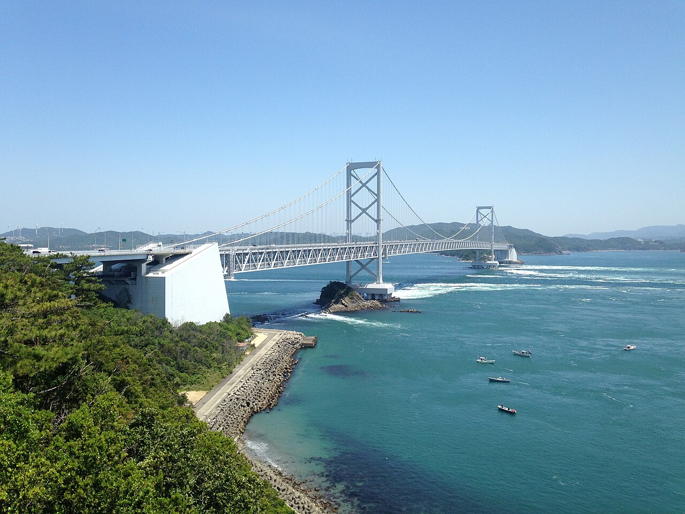

冬天去鸣门看漩涡，最值得先决定的是“从哪里看”，而不是先订一张名字里带观潮的票。大鸣门桥下的收费步道“渦の道”，与观潮船、架桥纪念馆エディ是不同设施。**2026年12月14日至16日，渦之道因自行车道相关工程临时休馆，预计17日恢复营业。**只有三天停留窗口的旅客，应先调整这一站。[官方临时休馆公告](https://www.uzunomichi.jp/info/19618/)

*照片摄于2016年5月5日，地点为鸣门公园茶园展望台，并非渦之道内部，也不代表2026年当日漩涡、船班或施工状态。作者[そらみみ（Soramimi）](https://commons.wikimedia.org/wiki/User:%E3%81%9D%E3%82%89%E3%81%BF%E3%81%BF)，[图片来源](https://commons.wikimedia.org/wiki/File:Onarutokyo_Bridge_from_Ochaen_Observation_Deck_in_Naruto_Park_1.jpg)，许可[CC BY-SA 4.0](https://creativecommons.org/licenses/by-sa/4.0/)。使用Wikimedia提供的1280像素缩略图，未另作修改。*

## 第一步：把日期与观看方式分开选择

通常日历写十二月第二个星期一休馆，但本次专项公告增加了周二、周三，不能按常规规则推断15日已恢复。另一方面，该公告针对步道，不是宣布海峡、全部船公司或周边城镇停业。计划改乘船的人，应重新核实具体运营方与码头，不把另一项体验当作自动可用的替代。

如果主要目的是从桥下俯视海面，改日期比硬换成船更符合期待；如果重点只是观察潮流，可在确认船班及自身乘船接受程度后比较方案。带怕高或容易晕船的同行者，先讨论哪一种更适合，不要到现场才发现全组对体验的理解不同。

## 有营业时段，不代表随时都有明显漩涡

渦之道冬季十月至二月开放9:00至17:00，16:30停止入场。官方另提供每日观潮参考时刻，并说明天气可能造成偏差。营业时长与潮汐窗口是两张表，不能用“下午还有票”证明下午任何时间都适合看漩涡。[营业时间与潮表入口](https://www.uzunomichi.jp/usage-guide-uzu-no-michi/)

实用的安排顺序是：先排除休馆日，再打开目标日期的潮表，最后把交通和午饭填入前后空档。不要保存首页“今天”的时刻就用于下个月，也不要拿一张很壮观的照片作为当天景象保证。即使看不到预想的完整涡形，海面变化与桥梁空间仍是参观内容，但应事先接受这种自然景观的不确定性。

例如，一天还要去其他设施，可把与潮汐有关的项目先固定，把不受潮汐约束的参观放到另一段。不是一定要上午进馆、下午看海；顺序应随所选日期调整，而不是照搬固定半日游模板。

## 共通券要看配对对象：船与纪念馆不是一回事

步道与观潮船的共通券已于2026年3月31日结束销售，官方说明停售前购买的券仍可使用。新规划冬游的旅客，不应继续按旧攻略寻找同一船舶套票。[船舶共通券停售公告](https://www.uzunomichi.jp/info/17832/)

这不表示所有组合票都取消。现行综合指南仍列渦之道加エディ的共通入馆券，成人900日元；步道单独成人票为510日元。买票时把所含设施名字逐项读完，不要只识别“共通”两字。若其中一处不在想去的清单上，套票也未必比单买更合适。[现行票种](https://www.uzunomichi.jp/usage-guide-uzu-no-michi/)

电子凭证应保留具体产品名与使用条件，准备方法见[日本景点电子门票检查清单](/blog/b-20261013-090003)。本文没有检查某一船班的实时库存，也不推荐未经核实的第三方观潮套餐。

## 到停车场以后，还要走到真正入口

官方FAQ提醒，渦之道与エディ均无专用停车场，应使用收费的鸣门公园停车场；导航直接输入步道名称可能指向错误位置，馆方建议设为エディ。两设施之间有较陡坡道，不能只凭地图显示相邻就当成完全平路。[官方交通与步行问答](https://www.uzunomichi.jp/faq/)

对行动缓慢的旅客，应把停车、取物、走到入口作为一段独立时间。轮椅或婴儿车的借用数量有限，有提供并不等于抵达时必定有空。可先用[带父母旅行的节奏安排](/blog/b-20261009-063208)筛出真正值得保留的体验，再决定是否两馆都去。

## 公园巴士站不等于回关西的高速站

馆方同时说明，鸣门公园内没有高速巴士乘车处；返回关西须另衔接“高速鸣门”等站点。预订长途车时要核对实际上车站，不要把游览终点与长途车出发地写成同一位置。[官方返程说明](https://www.uzunomichi.jp/faq/)

行程表最好留下两行交通：公园到长途站，以及长途站到目的地。各段班次、换乘步行与天气影响分别核对。这样即使当天缩短步道停留，也知道应该往哪里走，而不是在海边等一辆根本不从此处发车的巴士。

*资料核验：2026年11月21日。*
