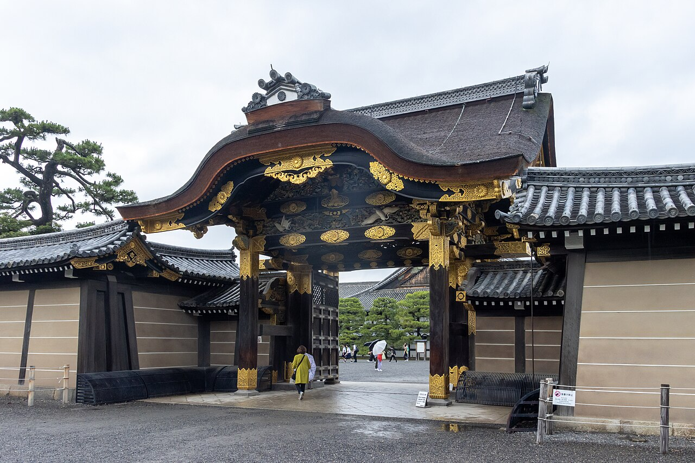

冬天去二条城，如果目标是看障壁画原作，应该找“二条城障壁画 展示收藏馆”，而不是把夜间灯光票当作白天看展的凭证。**2026年冬期原画公开从11月19日至2027年1月17日，100日元展示馆门票之外，还需入城票。**年末则要分清全城关闭和宫殿停止参观两种情况。[官方冬期原画公开安排](https://nijo-jocastle.city.kyoto.lg.jp/introduction/tenji/)

## 这次看的是黑书院相关原画

冬期主题为“華麗なる宴の場”，对应黑书院一之间、二之间。展示收藏馆为了保存与公开障壁画而设置，定期按房间或主题选择作品展出，并非把所有原作永久摆在同一展厅。[展示收藏馆介绍](https://nijo-jocastle.city.kyoto.lg.jp/introduction/tenji/)

因此，想看某一幅具体作品的人，应先核对当期展示内容，而不是从二条城的整体介绍里挑一张图片便认定一定在场。对第一次参观者，我更建议先理解画面原本属于怎样的房间，再看人物、植物或背景怎样构成空间气氛，不必把这里当成一口气看完全部城堡艺术的任务。

观看建筑和观看原画，是互相补充的两件事。建筑提供房间尺度与行走关系，原画展则让你把注意力放在作品本身。若时间不足，按兴趣选重点，比为了“全都包括”连续赶三处入口更有意义。

*2024年6月23日唐门普通外观，非本季原画展或冬季现场。Photograph by [Mike Peel](https://www.mikepeel.net)；[Wikimedia Commons原文件](https://commons.wikimedia.org/wiki/File:At_Kyoto_2024_395.jpg)，[CC BY-SA 4.0](https://creativecommons.org/licenses/by-sa/4.0/)。使用Wikimedia提供的1280像素缩略图，未另行裁切或修改。*

## 三个结束时间，不要只记17点

二条城白天入城受理到16:00，17:00闭城；展示收藏馆入馆受理到16:30，16:45闭馆。也就是说，人在城外时，不能因为展馆还受理到16:30，就推定16:20才到城门仍来得及。[入城时间](https://nijo-jocastle.city.kyoto.lg.jp/guide/annai/)、[展示馆时间](https://nijo-jocastle.city.kyoto.lg.jp/introduction/tenji/)

建议把原画展排在白天行程的前半段，至少别把它留作“其他地方走完还有空再看”。城门、售票与展馆不是一个位置，同行集合、洗手间或取出电子票也会消耗时间。这里不提供统一的最晚抵达建议，关键是给自己的步速留出余量。

## 年末先查全城，再查每座宫殿

官网列明全城12月29日至31日关闭。二之丸御殿另有12月、1月的每周二休止规则，以及12月26日至28日、1月1日至3日停止参观；遇指定节假日还有调整。本丸御殿有自己的定期休止安排，不能用二之丸日历替代。[官方休城与休殿规则](https://nijo-jocastle.city.kyoto.lg.jp/guide/annai/)

冬期原画公开页面列出的展馆休馆是12月29日至31日。由此安排跨年参观时，应逐项写下“能入城吗、展馆开吗、想看的宫殿开吗”，不要只问一句“二条城元旦开不开”。即使园区开放，也不等于两座宫殿都能进入。

如果本丸御殿也是主要目标，还要另外处理事前预约与时间指定票。把已经预约的时段放在行程中心，再安排其他展区，避免在原画展看到一半才发现需要穿过城内赶另一处报到。

## 100日元只回答了展馆这一项

展示收藏馆公布入馆费100日元，学龄前儿童免费，并明确另需入城费。预算时应按自己实际选择的区域核对组合，而不是搜索到最低数字就当成整次参观价格。[展示馆收费说明](https://nijo-jocastle.city.kyoto.lg.jp/introduction/tenji/)

付款前把票名读完整，确认是白天入城、宫殿参观，还是另外举办的夜间活动。有关夜场可参考[二条城NAKED夜展票种](/blog/d-20261027-090005)，但那篇不提供本次原画展入场资格。电子票的准备方法则可看[日本景点电子凭证清单](/blog/b-20261013-090003)。

## 把看展和冬季休息安排在一起

冬季参观不是只有展厅内的停留，还包括城内室外移动。同行有人怕冷或不适合久站时，减少连续参观区域，提前约定休息与会合地点。拍摄遵守各区告示，宫殿内部不可摄影，不能因为庭园有人拍照就认定室内也一样。

离开前再确认随身物品和回酒店的交通，不必为了一个空档硬加远处寺院。原画公开的价值在于看清细节，而不是让跨年清单多一个打勾。
