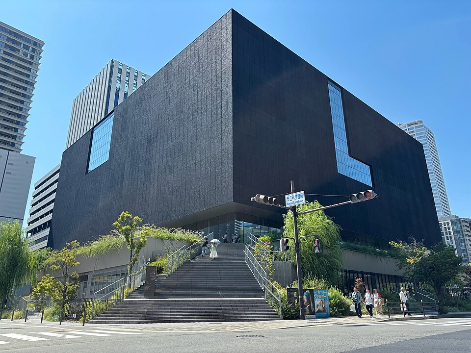

冬天在大阪安排室内半日，中之岛美术馆同时举行的两场展览容易让人想“一次看完”。真正需要先比较的不是哪张海报更有名，而是票券涵盖哪场、自己愿意看多久，以及周五两层展厅并不同时关门。只记住整栋建筑的地址，仍可能错过想看的那一场。

*建筑识别参考：2026年8月24日实拍，画面中的历史展览海报不代表当前展览。摄影：Sakai Yayoi；[原图与作者](https://commons.wikimedia.org/wiki/File:NAKKA.jpg)，[CC0 1.0](https://creativecommons.org/publicdomain/zero/1.0/)。使用Commons提供的960像素版本，本站未修改画面。*

## 4楼和5楼，主题与结束日期不同

4楼是“大英博物館日本美術コレクション 百花繚乱〜海を越えた江戸絵画”，从2026年10月31日至2027年1月31日；5楼“NHK日曜美術館50年展”从10月10日至12月20日。12月下旬才到大阪的人，不能再按照11月的双展安排购买行程。[大英展馆方页面](https://nakka-art.jp/exhibition-post/daiei-ten2026/)、[NHK展大阪场信息](https://nichibiten50.jp/)

前者以江户绘画和浮世绘等为主要入口，后者把节目介绍过的作品与影像内容结合。喜欢纸本画、屏风和版画的旅客，可以先看4楼；喜欢跨时代作品与艺术故事的人，可以先比较5楼。两场都想看才需要双展方案，不必把“同一栋楼”当作必须两场全买的理由。

## 成人套票4000日元，先算兴趣再算差价

普通成人单独购买，大英展2300日元，NHK展2000日元，合计4300日元；官方另售成人双展套票4000日元，10月31日至12月20日在ART PASS与美术馆销售，较两张普通成人票少300日元。NHK展不是日期时段指定制，但拥挤时可能限制入场。[NHK展大阪票价及双展套票](https://nichibiten50.jp/tickets.html)

300日元的差额值得知道，却不应决定整个下午。只想看一场的人，买另一场并不叫节省；带学生或孩子的人，也不要把“成人套票最划算”直接套给全家，先逐人比较适用票种。不要把售票页上已经结束的前售、其他巡展城市的优惠当成大阪当前票价。

买到套票后，仍应检查凭证上每场的使用方式和有效期，不能自行推断一定可以任意分日、任意重入。官方总览未说明的细节，以具体售票说明及现场确认处理，本文不补造一个“最方便”的使用规则。

## 周五先看5楼，再考虑4楼晚场

大英展通常10:00至17:00，周五延至20:00，最后入场提前30分钟；NHK展公布的是10:00至17:00、16:30停止入场，没有同样的周五延时。因此，“晚上到中之岛看双展”不是两边都可执行的计划。[大英展开场时间](https://nakka-art.jp/exhibition-post/daiei-ten2026/)、[NHK展开场时间](https://nichibiten50.jp/)

若在周五白天已有空档，想两场都看，可以优先安排较早关门的5楼，再在体力允许时转向4楼。这只是按截止时间倒推的建议，不保证排队或个人看展时长。下午很晚才到，则先选最想看的那场，不为了用完套票而在两个展厅间赶路。

11月23日虽是周一，两展均开放；24日休馆。连休前后应按具体展览日历判断，而不是只记“日本馆都周一关门”。年末只有大英展仍在会期内，也仍有自己的休馆日，出发前再核对。

## 作品与影像，给停留方式留差异

看纸本作品可以挑几件仔细比较线条和构图；遇到影像则先判断是否想完整观看，不必每段都停留到结束。同行者节奏不同，可以事先约定会合方式，别把某个人“已经看完”的速度当成全家的统一标准。

看过宣传图后更应区分原作、影像及图录，不要因为节目曾介绍某件名作，就推断它的原作必定在大阪展厅。出品目录与现场标识才是确定展示内容的依据。摄影许可也应逐区看，不能将官网上有照片理解为游客可自由拍摄。

## 一馆两场已经足够，别再硬塞跨区行程

去馆前解决大行李与午餐，入馆后按自己重点留时间。需要休息时，不必马上追加天保山或别处的室内景点；天气好可在离馆后短走一段，天气差就直接用餐回酒店。其他雨天选择见[大阪室内备用路线](/blog/d-20261009-063202)。

寄物与参观准备可参考[日本美术馆指南](/blog/b-20261011-090008)，票券整理见[电子门票检查](/blog/b-20261013-090003)。本文核验于2026年11月15日，不保证即时余票、排队时间或临时开放。
