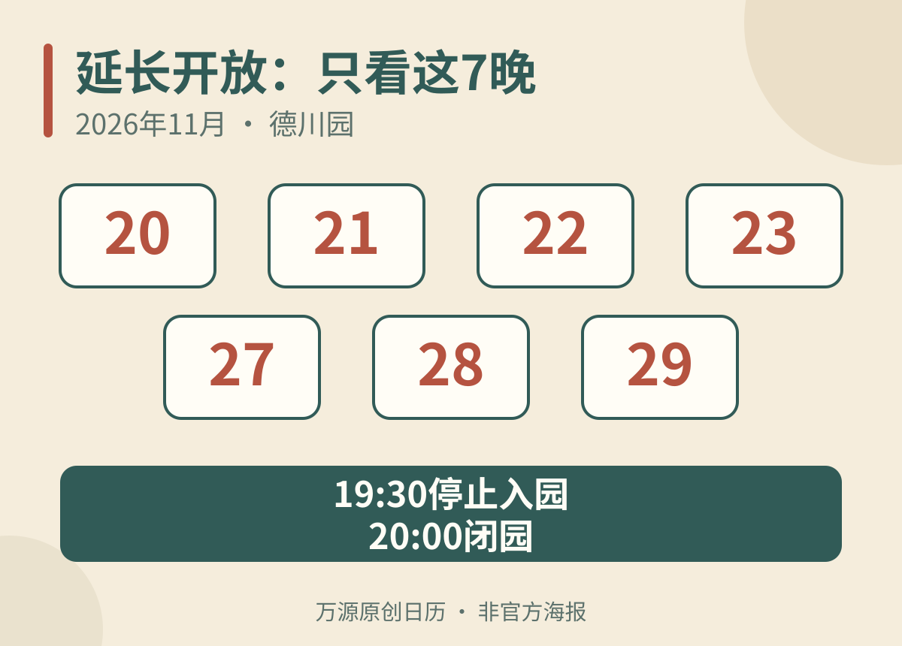

名古屋德川园2026红叶祭从11月14日至12月6日举行，**开园日16:00开始的“红叶灯路”，并不表示整段会期都营业到晚上**。想晚餐后入园，必须选七个延长开放日；其他开园日仍在17:00停止入园、17:30闭园。[德川园11月当季公告](https://www.tokugawaen.aichi.jp/)

只有一晚在名古屋，建议先决定想看暮色里的园路，还是完全入夜后的庭园，再把日期和晚餐顺序排进去，不要先订好19点晚餐后才发现当晚没有夜场。

## 七个延长日，逐日核对

当季夜间开放仅为以下日期：

- 11月20日，周五。
- 11月21日，周六。
- 11月22日，周日。
- 11月23日，周一、祝日。
- 11月27日，周五。
- 11月28日，周六。
- 11月29日，周日。

<figure>
  
  <figcaption>原创七晚日期整理，非官方海报；只列延长开放日期，休园日及其他开园日规则见正文。 万源原创图示（AI辅助）。</figcaption>
</figure>

这些日期从9:30开放至20:00，**19:30为最后入园时间**。红叶祭最后一周的12月5、6日不在延长名单里，不能因为是周末就自动安排晚间入园。[爱知县官方当季活动页](https://aichinow.pref.aichi.jp/events/detail/1793/)

11月23日逢祝日开放，随后24日休园。结合每周一休园规则，活动期间另外两个休园日为11月16日、30日。休园日不适用“每天16点点灯”的宣传措辞；台风等情况也可能造成临时闭园。[官方休园规则](https://www.tokugawaen.aichi.jp/guide/index.html)

## 普通开园日，可以看灯路，但要早进园

园方将和纸、陶器和竹制行灯布置在园路，活动期从16:00起点亮。普通开园日17:30就要离园，这更适合下午开始、走到暮色时结束的一段散步，而不是夜间长时间拍摄。[园方本月说明](https://www.tokugawaen.aichi.jp/)

若选择七个延长日之一，可以把下午园景与夜色安排在同一次入园里，先看池水、地形与园路，再等灯光显现。仍须留出用餐时间，不要假设园内每处餐饮都会随庭园一起延长，或离园吃饭后可以凭原票无限次回来。

点灯日期也不是红叶见顷预报。本文确认的是开园安排，没有认定某一天一定全红；若景色是此行唯一目的，出发前再看园方当天照片和公告。

## 园票300日元，隔壁美术馆是另一项参观

德川园当前一般、高中生及大学生个人票为300日元，初中生及以下免费。65岁以上100日元优惠仅限名古屋市内居民，并需出示相应证明，游客不能仅按年龄套用。两名普通成人的庭园票预算为600日元。[官方入园费](https://www.tokugawaen.aichi.jp/guide/index.html)

当季活动页面未列独立夜场加价，普通庭园票可按当日开放时段使用。若另买名古屋城、白鸟庭园等共通券，应分别确认另一设施的开放日，不要把组合票理解为设施同时开放。

德川园与德川美术馆相邻，名称和行程容易混在一起，但庭园300日元不是美术馆门票，夜间延长也不意味着馆内展览延长。想看收藏与庭园，应先把室内参观安排在该馆独立开放时段，再接散步；只想夜游园林，则不必为凑满一天强加另一张馆票。

## 从大曾根站走来，注意铁路与地铁出口不同

德川园交通页列明：JR中央本线大曾根站南口步行约10分钟；地铁名城线大曾根站3号出口约15分钟；名铁濑户线森下站约8分钟。名古屋站或荣出发，也可查基干2号巴士至“德川园新出来”，下车后步行约3分钟。[园方交通指引](https://www.tokugawaen.aichi.jp/transportation-guide/index.html)

“到大曾根站”并不等于已经在JR南口，选择地铁时不要直接套用JR出口的步行时间。带长辈或婴儿车，应另查自己所乘线路的电梯路线；购票、过街与园门核验也不包含在步行分钟数里。

自驾则要分清停车场：北地下停车场普通车开放到23:00，限高2.1米；南停车场常规开放至17:45。需要停到夜场结束时，不应仅看到“德川园停车场”就入库，先确认自己车种、当晚可用入口及退场时间。

## 德川园和东山夜枫，选一个完整晚上

两处都在名古屋，却不适合只因同为“七晚”就当作相同日历。德川园含11月20、27日两个周五；[东山植物园当季夜场](/blog/higashiyama-autumn-lightup-2026)则还有12月5、6日，入口和闭园时间也不同。

喜欢紧凑的日本庭园散步，可优先德川园；已经打算白天看东山动植物园，则另核东山晚间开放区域。把一晚留给一处，通常比在两园间转车、赶最后入场更从容。白天城市部分可参考[名古屋一日游两种主线](/blog/d-20261012-090008)，保留傍晚休息，不必同时塞入城郭、博物馆和两处夜枫。

*核验日期：2026年11月12日。七晚日期与票价按当前官方公告，实时叶况、临时休园及交通另查。*
