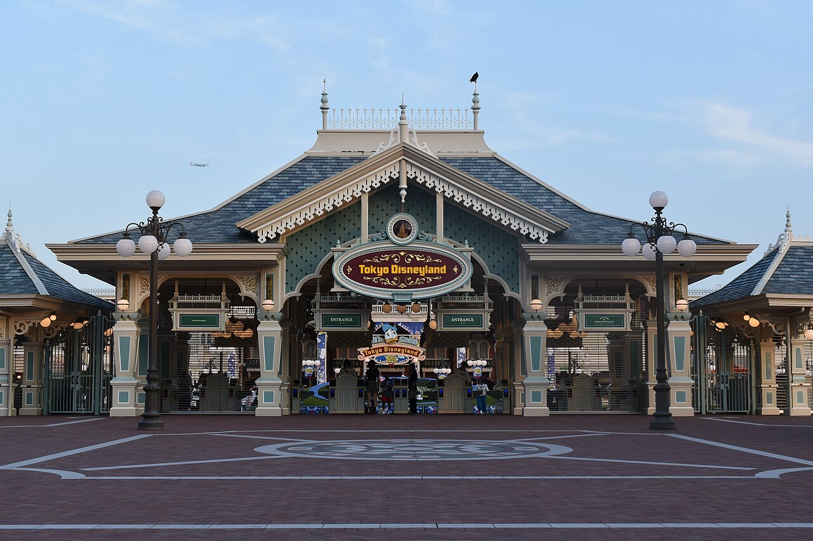

两位成人带着年幼孩子去东京迪士尼，遇到孩子不符合身高或其他乘坐规定的项目，不一定只能让其中一人放弃。官方“交代利用サービス”允许符合条件的同行者轮流体验，同时始终有人陪着不能乘坐的人。不过，它不是托儿服务，也不是把一份付费优先体验变成两个人共用。

## 一、先确认需要解决的是哪种问题

官方定义针对同行者中有人不满足游乐设施使用规定的情况，由两名或以上监护人、陪同者轮流照顾。不能把“全家不想排队”直接等同于符合服务条件；孩子只是临时不愿意坐，是否适用也应先问现场工作人员。[交替利用官方问答](https://faq.tokyodisneyresort.jp/answer/67eaa64138a1ebab2162daf6/)

每个项目的身高、坐姿等限制应分别查询。园方还说明，未满7岁的儿童体验设施时需要16岁以上者陪同。提前挑选时，不只看宣传照片刺激不刺激，也要看孩子能不能按设施要求乘坐。[游乐设施使用规定](https://faq.tokyodisneyresort.jp/answer/6a686873b2428f4e88bcdac3/)

因此，家庭行程先分成“全员可玩”和“成人希望轮流玩”两栏。不要把所有热门设施都列入第二栏，否则孩子的一天可能变成在不同入口等大人。每位成人先选一项最重视的体验，其余时间留给能共同参与的内容，会更容易控制总时长。

照片：东京迪士尼乐园普通入口参考，拍摄于2025年6月19日，不代表交替利用服务柜台、2026年活动布置或当天人流。作者：[Fred Cherrygarden](https://commons.wikimedia.org/wiki/User:Fred_Cherrygarden)；[图片来源](https://commons.wikimedia.org/wiki/File:Tokyo_Disneyland_Main_Entrance_(June_2025).jpg)；许可：[CC BY-SA 4.0](https://creativecommons.org/licenses/by-sa/4.0/)。使用Wikimedia提供的1280像素缩略图，未另作修改。

## 二、排队前提出，不要到乘车口才分组

官方要求携带园区门票，在加入队列之前向该设施工作人员询问。先体验的一组正常排队；后体验的一组由工作人员根据等待情况设置时间，按指定时间回来交接，不必重新从队尾完整排一次。它减少第二组重复等待，不等于第一组也免排队。[服务办理与轮流方式](https://faq.tokyodisneyresort.jp/answer/67eaa64138a1ebab2162daf6/)

以两位成人和一名不能乘坐的孩子为例，先商量谁先坐、谁陪孩子，再一起把需求说清楚。确认后组几点回来、在哪里联系工作人员，以及孩子如何从一位成人交给另一位。不要先让一人排进去，另一人走到很远的餐厅，之后才尝试远程补办。

现场可简短表达：“交代利用サービスを利用したいです。”随后说明同行人数与不能乘坐的原因即可。听不清返回时刻时，请对方在票券记录或现场说明中指出；不要根据队伍显示的预计等待分钟数自行猜一个会合时间。

## 三、用DPA，两位乘坐成人各自需要一份

如果选择Disney Premier Access，即DPA付费优先体验，不能只给先坐的人买一份，再靠交替利用让另一位成人免费使用。官方要求需要体验的所有人各自购买，并在设施指定使用时间全员到齐后向工作人员提出交替利用。[交替利用的DPA条件](https://faq.tokyodisneyresort.jp/answer/67eaa64138a1ebab2162daf6/)

DPA本身与入园票另外收费，一份不能多人共用，且有售罄可能。购买前先核对参与者名单和时间，不要让两人各自抢到完全不同的时段，再默认现场一定能合并。[DPA官方服务说明](https://www.tokyodisneyresort.jp/tdr/guide/app_service/disneypremieraccess.html)

这笔预算应按真正乘坐的人数计算，而不是按“家长组”计算。照顾孩子的安排解决了轮流体验的问题，并没有替家庭减少购买人数。若预算不合适，可以选择正常排队配合服务，或直接放弃其中一项成人项目，不必为了已经排好的计划不断加钱。

## 四、交替期间别安排另一项硬预约

后组等待时可以围绕孩子的需要安排附近活动，但要保证能在指定时间回来。先问清楚再决定去哪里，不把这一段当作可自由走远的整块空闲。特别是喂食、换尿布与孩子入睡可能不按分钟结束，不宜再叠加一场需要准时入场的演出或餐厅预约。

全家门票都集中在一部手机时，也要确认后组如何出示自己的票。可提前参考[电子票与同行者管理](/blog/b-20261013-090003)，但最终以工作人员给出的该项目流程为准。更换陪同者时，把随身包、孩子用品和通信设备一起交接，避免一位成人进了设施后才发现手机也被带走。

## 五、每人一次，轮流不等于重复乘坐

官方说明每人限体验一次；若实际乘坐者合计三人，可能有一人单独乘坐。不要安排已经完成体验的人再陪第二组多坐一次，也别把三人同行自动理解成始终可以两两结伴。[人数与次数说明](https://faq.tokyodisneyresort.jp/answer/67eaa64138a1ebab2162daf6/)

当天先做好一轮再判断是否继续，而不是把所有项目都按理论最短时间拼起来。带婴儿车前往度假区，还可提前看[婴儿车与电车换乘准备](/blog/b-20261012-090001)。顺利完成交替的目标，是大人得到想要的体验、孩子始终有人照顾，而不是让全家不断赶下一次轮换。
