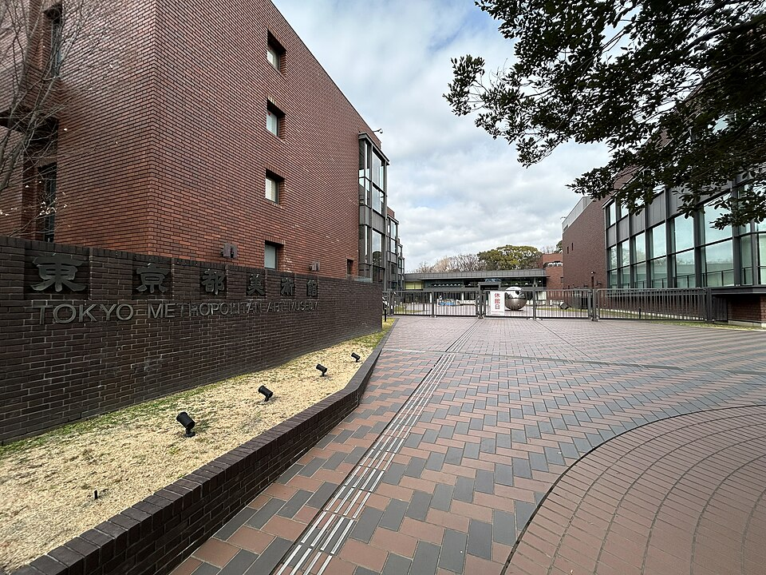

2026年11月14日起，上野多了一项适合冬季的室内主行程：东京都美术馆的“オルセー美術館所蔵 いまを生きる歓び”。这不是把巴黎整座美术馆搬来，也不必为了“名画都到了”给自己列一张必须看完的清单。先确认票券和当天开放时间，再挑几件想认真看的作品，比到馆后抢着追照片更从容。

*建筑识别参考：2025年2月3日实拍，并非本届展览现场。拍摄当日的休馆牌不代表当前营业。摄影：An aggressive and ambiguous amphibian's absurd and adaptable anagram alarmed all ants；[原图与作者](https://commons.wikimedia.org/wiki/File:Tokyo_Metropolitan_Art_Museum_front_and_signage.jpg)，[CC0 1.0](https://creativecommons.org/publicdomain/zero/1.0/)。使用Commons提供的960像素版本，本站未修改画面。*

## 开幕后看普通票，不再追前售价格

展期为2026年11月14日至2027年3月28日。本展**无需预约入场日期和时段**，但买到票并不免除现场等候。成人普通票2400日元；前售已于11月13日23:59结束，旧页面上的2200日元不能继续当作现售价格。[官方门票说明](https://art.nikkei.com/orsay2627/)

如果日程尚未确定，不必为找不到“选时间”按钮而怀疑自己漏了预约。相反，带孩子、长者或需出示优惠证明的人，要先确认所选票种与资格；购票凭证和证明文件是两回事。全家同行最好由一人整理票券清单，但让每位成人知道如何打开自己的入场凭证，避免在入口处临时翻聊天记录。

## 同是电子票，截图并不都能入场

官方销售说明区分得很明确：etix及ARTPASS可出示手机二维码或打印票面；Asoview与乐天旅游体验则需在手机上完成入场操作，**打印件和屏幕截图不可替代**。会期中也在馆内售票柜台卖普通票，但现场购票与排队都需要时间。[官方购票渠道与出示方法](https://art.nikkei.com/orsay2627/ticket/)

出发前实际打开一次订单，确认网页能载入，而不是只保存付款成功的邮件。若同行人手机没有网络，先考虑适合自己出示条件的官方渠道，不要购完后才发现它要求实时操作。更通用的准备方式见[日本景点电子门票检查](/blog/b-20261013-090003)。

主办方11月11日另发布了Asoview及ARTPASS所用邮件服务发生不正访问、可能涉及购票者资料的通知，调查及个别联系由相关公司处理。已经通过这两个渠道买票的人，应从展览官网进入通知和服务商说明；不要因为陌生邮件写对了展名就点击补款或登录链接。这不是展览取消或票券自动失效的公告。[主办方重要通知](https://art.nikkei.com/orsay2627/assets/pdf/ticket_news.pdf)

## 周五可晚看，圣诞前后却有休展空档

通常9:30至17:30开放，周五延长到20:00，均在闭室前30分钟停止入场。周一通常休展，11月23日开放、24日休展；12月21日为周一，随后12月22日至2027年1月3日也休展。**不能把“展览到3月”理解成圣诞假期每天开放。**其他月份的例外请对照完整日历。[官方开放日期](https://art.nikkei.com/orsay2627/outline/)

周末到访不能把周五晚场套过来；普通周六、周日按17:30闭室安排。如果只有下午的一小段空档，先评估剩余时间是否足够，再决定是否买票；最后入场只是许可边界，不是适宜抵达时间。周五想晚看，可把晚餐与看展分开留时间，不把餐厅预约压在预计离馆的那一分钟。

## 按兴趣看一场，不必把上野各馆都排满

馆方介绍，本展围绕日常生活中的喜悦，展示绘画、雕塑、工艺及摄影等约110件作品，分七个篇章。它适合从一个熟悉的作者切入，再看看同一主题如何被不同媒介表达，而不是只绕着最有名的画作排队。[馆方展览介绍](https://www.tobikan.jp/en/exhibition/2026_orsay.html)

可以让同行者各选一个感兴趣的主题，入馆后先看展厅顺序，再决定停留。若喜欢听解说，给语音导览留余量；若只是旅行中轻松看展，选几件认真看也成立。摄影范围按现场标识，不把官网展示图片当成游客拍摄许可。

雨天看展之前先安排行李，结束后在上野附近吃饭或散步即可。与其为了“一次把两馆看完”牺牲休息，不如把第二馆留作可取消项。看展礼仪、寄物和闭馆前节奏可继续参考[日本美术馆参观准备](/blog/b-20261011-090008)。本文核验于2026年11月15日；未核验即时排队长度，临时调整以主办方公告为准。
