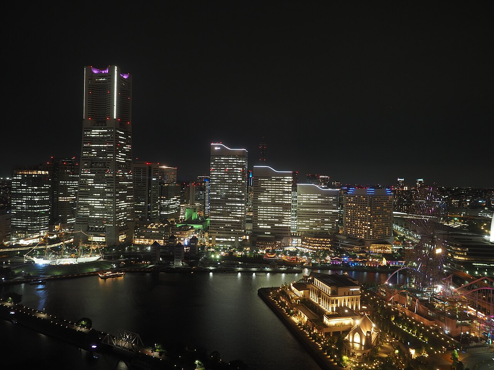

想在横滨把港口夜景和圣诞气氛一次看完，先不要把所有活动当成同一张日历。**2026年ヨルノヨ（YORUNOYO）是12月4日至30日，Christmas Gate则在12月25日结束。**前者公布时间为17:00至21:05、免费观赏；11月下旬已经有圣诞市集，不代表城市联动灯光也已开始。[YORUNOYO官方总览](https://yorunoyo.yokohama/)

## 先选日期，再决定要看什么

11月20日至12月3日来访，可以考虑新港中央广场的Christmas Gate，但不要以为能看到YORUNOYO的城市联动演出。12月4日至25日是两项活动的重叠期；26日至30日仍在YORUNOYO会期内，却不能再把该市集当作晚餐或购物停靠点。

Christmas Gate开幕日11月20日17:00开始，之后公布营业时间为11:00至21:05，餐饮最后点单20:30。活动里的YORUNOYO商店另有销售开始时间，不宜把广场营业时间理解成每一家摊位全天同时营业。[Christmas Gate官方详情](https://yorunoyo.yokohama/contents/christmas-gate/)

如果只剩一个晚上，我更建议先决定“看城市灯光”还是“逛市集吃东西”。前者围绕一个观景位置排时间，后者先解决营业与入场条件，再把附近灯景当加分项。两种目的都想做到，可以放在重叠期，但不必再加入一整段中华街晚餐排队。

## 五分钟演出，不等于整晚持续同步

官方把城市光与音乐联动项目称为“ハイライト・オブ・ヨコハマ”，单次约五分钟。大栈桥国际客船码头被列为主要观赏点；山下公园、日本丸纪念公园等地另有各自的光影内容。它们共同构成滨海夜游，并不是所有景观都集中在同一个入口。[2026年详细公布](https://yorunoyo.yokohama/news/yorunoyo2026-shosai/)

Christmas Gate的树在12月4日起参与整点、半点的五分钟联动；但红砖仓库公园内圣诞树参与联动的场次仅列出17:00、19:00、21:00。这是不同设施的配合安排，不能把某一棵树的时刻当成全城所有项目的统一时刻表。[官方联动说明](https://yorunoyo.yokohama/contents/christmas-gate/)

实际排程可以这样做：选定一个主观赏区，提前到附近辨认视线和出口；完整看完一场，再决定向下一处步行。不要在五分钟开始时才从市集动身，也别为了赶下一轮在道路中间停留拍摄。同行有人走得慢时，保留一个观赏点比追满所有区域更稳。

## 免费区域与红砖仓库市集分开核对

YORUNOYO免费、Christmas Gate也标示免费入场，但这不表示附近所有圣诞活动都免票。尤其“Christmas Market in 横浜赤レンガ倉庫”是另一个需要核对票种和日期的项目，不应只凭地图上都写着圣诞市集就直接套用。

已计划进红砖仓库市集，可先看[横滨圣诞市集票种与排队区别](/blog/d-20261031-110002)，再回到当季售票页核实所选日。若只想散步看灯，不必为了“顺路”额外买自己不打算使用的票。

*2025年5月港未来普通夜景，非2026ヨルノヨ装置或亮灯效果。摄影：Insightwm；[Wikimedia Commons来源](https://commons.wikimedia.org/wiki/File:Night_view_of_Minato-Mirai_area.jpg)，[CC BY-SA 4.0](https://creativecommons.org/licenses/by-sa/4.0/)。使用Wikimedia提供的1280像素缩略图，未另行裁切。*

这张普通夜景照片适合帮助辨认港口与城市建筑的关系，不能拿来对照今年灯光的颜色、装置位置或表演效果。收藏行程时，也应把日常观景地标与限期活动内容分开：前者用于找方向，后者必须看当季说明。尤其不要凭往年社交平台照片，认定某个临时装置今年仍在原处。

## 回程比最后一张照片更值得先确认

本文不预判当天风力、降雨或人流。出门前看官方临时通知和天气，把室外停留时间按同行者体力缩短。手机保留电量用于导航与回程，拍摄时不占用通道，也不跨越现场围挡。

白天还想去中华街，可参考[横滨半日到一日游组合](/blog/d-20261011-090003)，但晚上只保留一个主要目标。把回程车站、最后一段步行和休息时间先放进计划，灯光就不必变成一路追赶的任务。
